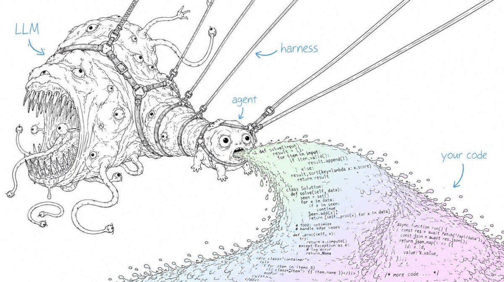

# Agentic AI Workflows & Harness Engineering

Fundamentals & How to Build Your Own. A set of linked pages on agentic AI workflows and harness engineering with Claude Code and Codex, written alongside a 45-minute talk.

Read it at <https://sergeiwallace.github.io/ai-harness-engineering/>.

## Contents

- [Introduction](https://sergeiwallace.github.io/ai-harness-engineering/)
  - [Introduction in detail](https://sergeiwallace.github.io/ai-harness-engineering/sections/00-landing-page/detail.html)
- [Talk slides](https://sergeiwallace.github.io/ai-harness-engineering/talk/): the slide list, a link to [present the slides](https://sergeiwallace.github.io/ai-harness-engineering/talk/slides/) and the PDF
- [Agentic AI fundamentals](https://sergeiwallace.github.io/ai-harness-engineering/sections/01-agentic-ai-fundamentals/)
  - [Agentic AI fundamentals in detail](https://sergeiwallace.github.io/ai-harness-engineering/sections/01-agentic-ai-fundamentals/detail.html)
- [AI harnesses](https://sergeiwallace.github.io/ai-harness-engineering/sections/02-ai-harnesses/)
  - [AI harnesses in detail](https://sergeiwallace.github.io/ai-harness-engineering/sections/02-ai-harnesses/detail.html)
- [Claude Code and Codex basics](https://sergeiwallace.github.io/ai-harness-engineering/sections/03-claude-code-and-codex/)
  - [Claude Code and Codex in detail](https://sergeiwallace.github.io/ai-harness-engineering/sections/03-claude-code-and-codex/detail.html)
- [Context files](https://sergeiwallace.github.io/ai-harness-engineering/sections/04-context-files/)
  - [Context files in detail](https://sergeiwallace.github.io/ai-harness-engineering/sections/04-context-files/detail.html)
- [Skills, commands and plugins](https://sergeiwallace.github.io/ai-harness-engineering/sections/05-skills-and-plugins/)
  - [Skills and plugins in detail](https://sergeiwallace.github.io/ai-harness-engineering/sections/05-skills-and-plugins/detail.html)
- [Hooks, scripts and linters](https://sergeiwallace.github.io/ai-harness-engineering/sections/06-hooks-scripts-and-linters/)
  - [Hooks and scripts in detail](https://sergeiwallace.github.io/ai-harness-engineering/sections/06-hooks-scripts-and-linters/detail.html)
- [Templates, prompt stubs and injected prompts](https://sergeiwallace.github.io/ai-harness-engineering/sections/07-templates-and-stubs/)
  - [Templates and stubs in detail](https://sergeiwallace.github.io/ai-harness-engineering/sections/07-templates-and-stubs/detail.html)
- [Agent profiles, sub-agents and delegation](https://sergeiwallace.github.io/ai-harness-engineering/sections/08-delegation/)
  - [Delegation in detail](https://sergeiwallace.github.io/ai-harness-engineering/sections/08-delegation/detail.html)
- [Coordinating several sessions](https://sergeiwallace.github.io/ai-harness-engineering/sections/09-session-coordination/)
  - [Session coordination in detail](https://sergeiwallace.github.io/ai-harness-engineering/sections/09-session-coordination/detail.html)
  - [Advanced session coordination topics](https://sergeiwallace.github.io/ai-harness-engineering/sections/09-session-coordination/advanced.html)
- [Orchestration and workflows](https://sergeiwallace.github.io/ai-harness-engineering/sections/10-orchestration/)
  - [Orchestration in detail](https://sergeiwallace.github.io/ai-harness-engineering/sections/10-orchestration/detail.html)
  - [Advanced orchestration topics](https://sergeiwallace.github.io/ai-harness-engineering/sections/10-orchestration/advanced.html)
- [Context window and memory](https://sergeiwallace.github.io/ai-harness-engineering/sections/11-context-window/)
  - [Context window in detail](https://sergeiwallace.github.io/ai-harness-engineering/sections/11-context-window/detail.html)
  - [Advanced context window topics](https://sergeiwallace.github.io/ai-harness-engineering/sections/11-context-window/advanced.html)
- [Testing agent-written code](https://sergeiwallace.github.io/ai-harness-engineering/sections/12-testing/)
  - [Testing in detail](https://sergeiwallace.github.io/ai-harness-engineering/sections/12-testing/detail.html)
  - [Advanced testing topics](https://sergeiwallace.github.io/ai-harness-engineering/sections/12-testing/advanced.html)
- [Code review](https://sergeiwallace.github.io/ai-harness-engineering/sections/13-code-review/)
  - [Code review in detail](https://sergeiwallace.github.io/ai-harness-engineering/sections/13-code-review/detail.html)
  - [Advanced code review topics](https://sergeiwallace.github.io/ai-harness-engineering/sections/13-code-review/advanced.html)
- [Human gates, decisions and alignment](https://sergeiwallace.github.io/ai-harness-engineering/sections/14-human-gates/)
  - [Human gates in detail](https://sergeiwallace.github.io/ai-harness-engineering/sections/14-human-gates/detail.html)
- [Browser automation and computer use](https://sergeiwallace.github.io/ai-harness-engineering/sections/15-browser-automation/)
  - [Browser automation in detail](https://sergeiwallace.github.io/ai-harness-engineering/sections/15-browser-automation/detail.html)
- [Logging, observability and evaluation](https://sergeiwallace.github.io/ai-harness-engineering/sections/16-logging-and-evaluation/)
  - [Logging and evaluation in detail](https://sergeiwallace.github.io/ai-harness-engineering/sections/16-logging-and-evaluation/detail.html)
  - [Advanced evaluation topics](https://sergeiwallace.github.io/ai-harness-engineering/sections/16-logging-and-evaluation/advanced.html)
- [Building your own harness](https://sergeiwallace.github.io/ai-harness-engineering/sections/17-building-a-harness/)
  - [Building a harness in detail](https://sergeiwallace.github.io/ai-harness-engineering/sections/17-building-a-harness/detail.html)
- [Trends and model changes](https://sergeiwallace.github.io/ai-harness-engineering/sections/18-trends/)
  - [Trends in detail](https://sergeiwallace.github.io/ai-harness-engineering/sections/18-trends/detail.html)
- [Chat, desktop and web clients](https://sergeiwallace.github.io/ai-harness-engineering/sections/19-chat-and-desktop-clients/)
  - [Chat and desktop clients in detail](https://sergeiwallace.github.io/ai-harness-engineering/sections/19-chat-and-desktop-clients/detail.html)

## Layout

- `sections/00-landing-page/index.md` is the landing page and introduction, served at the site root, with the table of contents. Its `detail.md` holds the story of the talk, the talk path and the credits.
- `talk/index.md` lists the talk's slides in order, each linked to its slide. `talk/slides/` is the built deck (reveal.js, served as static files; slide N opens at `talk/slides/#/N`, counting from 0), with `THIRD-PARTY-NOTICES.txt` for the libraries and fonts it bundles, and `talk/agentic-ai-workflows-harness-engineering.pdf` is the PDF. `_data/slides.yml` maps each section to its slides, and every page's header and footer link the first one.
- `sections/NN-slug/` holds one topic each, numbered from 01: `index.md` is the section page, `detail.md` the detail page, and `advanced.md`, where present, the advanced page.
- `_data/pages.yml` is the reading order. The table of contents and the previous and next links at the top and bottom of every page are built from it (`_includes/page_toc.html`, `_includes/page_nav.html`).
- `_config.yml` configures Jekyll and the Just the Docs theme. GitHub Pages builds the site from this repository's default branch.

## Licences

| Licence | Applies to | Files |
|---|---|---|
| CC BY 4.0 ([LICENSE-CONTENT](LICENSE-CONTENT)) | Prose and diagrams | Every `.md` file, including `talk/` and `sections/`, and the diagrams in `assets/diagrams/` |
| Apache-2.0 ([LICENSE](LICENSE)) | Code and configuration | `_config.yml`, `_data/`, `_includes/`, `.gitignore` and any code added later |

The illustration in `assets/images/` was supplied by the site owner. Its source and licence are not yet recorded, so neither licence above covers it.

## Credits

- The site uses the Just the Docs theme (<https://github.com/just-the-docs/just-the-docs>).
- The coordination examples use firstmate, an open-source project by GitHub user kunchenguid (<https://github.com/kunchenguid/firstmate>). I use my own public fork with customizations for my setup (<https://github.com/sergeiwallace/firstmate>).
