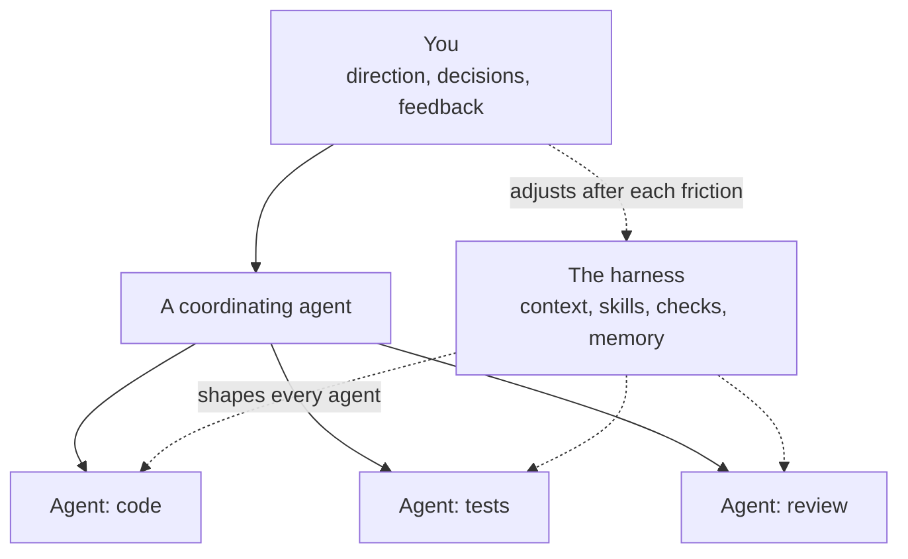



# Agentic AI Workflows & Harness Engineering

Fundamentals & How to Build Your Own
{: .fs-6 .fw-300 }

As of 2026-11-09.

{: style="width: 100%" }

This site teaches how to work with AI coding agents such as Claude Code and Codex, and how to build a harness around them: the context, tools, checks and helpers that make an agent work the way you work. The same content serves a 45-minute talk and this set of linked pages. This page is stop 1 on the talk path, about 2 minutes.

## Who this is for

Anyone who uses AI models for work. The examples come from software engineering, where agents run in a terminal and change code, but most of the ideas also apply, in adapted form, to people who use the chat and desktop apps (see [Chat, desktop and web clients]({{ '/sections/19-chat-and-desktop-clients/' | relative_url }})). You do not need a harness to start; the site shows what one is, how the parts fit, and a first week of steps to build your own.

## The conductor model

Think of yourself as a conductor with an orchestra. You direct a group of agents through workflows, and you keep adjusting the harness so they need less direction. In a more advanced setup, agents coordinate among themselves on long tasks; you give the starting direction and step in on decisions, blockers and feedback.

My own harness appears throughout as one example of what is possible. It is described conceptually: what each mechanism does and how it is wired, without the code itself. A copied harness brings its author's habits and problems with it, so take the ideas and build from the problems you hit yourself.

## How the site is organised

The talk runs from the basics to building your own harness.

1. What makes a model agentic, and what a harness is ([fundamentals]({{ '/sections/01-agentic-ai-fundamentals/' | relative_url }}), [harnesses]({{ '/sections/02-ai-harnesses/' | relative_url }})).
2. The building blocks that Claude Code and Codex provide: [the clients]({{ '/sections/03-claude-code-and-codex/' | relative_url }}), [context files]({{ '/sections/04-context-files/' | relative_url }}), [skills and plugins]({{ '/sections/05-skills-and-plugins/' | relative_url }}), [hooks and checks]({{ '/sections/06-hooks-scripts-and-linters/' | relative_url }}) and [templates]({{ '/sections/07-templates-and-stubs/' | relative_url }}).
3. How the blocks combine: [delegation]({{ '/sections/08-delegation/' | relative_url }}), [coordination]({{ '/sections/09-session-coordination/' | relative_url }}), [orchestration]({{ '/sections/10-orchestration/' | relative_url }}), [context management]({{ '/sections/11-context-window/' | relative_url }}), [testing]({{ '/sections/12-testing/' | relative_url }}), [review]({{ '/sections/13-code-review/' | relative_url }}), [human gates]({{ '/sections/14-human-gates/' | relative_url }}) and [measurement]({{ '/sections/16-logging-and-evaluation/' | relative_url }}).
4. How to [build your own harness]({{ '/sections/17-building-a-harness/' | relative_url }}) and keep it current [as models change]({{ '/sections/18-trends/' | relative_url }}).

Each topic has two pages. The section page is an overview you can learn from on its own, with a worked example for each idea. The detail page is a deep dive with diagrams, snippets, real examples and sources. Every page has previous and next links at the top and bottom, and a link back to the contents below. The [talk slides]({{ '/talk/' | relative_url }}) page lists the slides in order, and [Introduction in detail]({{ '/sections/00-landing-page/detail.html' | relative_url }}) has the full story of the talk, the talk path with its minutes, and the credits.

## One idea to take away

Enforce as much as possible in code, and rely on written instructions only where code cannot do the job. An agent follows an instruction most of the time and slips more as its context fills; a hook, test or check runs the same way every time. [Hooks, scripts and linters]({{ '/sections/06-hooks-scripts-and-linters/' | relative_url }}) shows how.

## Contents




