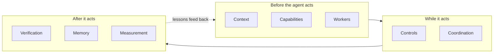
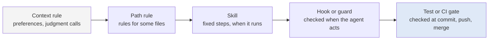



# AI harnesses in detail

As of 2026-11-09.

This page defines a harness, walks through each of its parts with what it does and how to start one, and covers the two ways of sorting the parts that the rest of the site uses: guides and sensors, and soft and hard enforcement. The [section overview]({{ '/sections/02-ai-harnesses/' | relative_url }}) is the short version.

## Contents
{: .no_toc .text-delta }

1. TOC
{:toc}

## Definitions

### The working definition

A harness is the software around a model that gives it safe access to tools, memory and checks, set up to match one person's preferences, workflows and projects. This is the definition from the talk's meeting description, and it puts the person at the centre: a harness fits one way of working.

### The 2026 usage

Birgitta Böckeler (Thoughtworks) wrote in April 2026 that "harness has emerged as a shorthand to mean everything in an AI agent except the model itself". By that reading, Claude Code and Codex are harnesses, and so is everything you add to them. This site uses "harness" for the whole stack and "my harness" for the layer I built on top of Claude Code and Codex.

### Harness engineering

Harness engineering is the practice of building and maintaining that layer: choosing which parts to add, writing them, checking that they help, and removing them when they stop helping. It borrows from software engineering (tests, review, version control) and from operations (logging, budgets, incident review).

## The eight parts

### Context

What it is: the instructions and knowledge the model reads. Context files (`CLAUDE.md`, `AGENTS.md`), path-scoped rules, procedure documents and the briefs one agent writes for another.

How to start: one hand-written context file per project with the build and test commands, the conventions a new teammate would need, and the mistakes you have had to correct twice. See [Context files]({{ '/sections/04-context-files/' | relative_url }}).

### Capabilities

What it is: what the agent can do beyond the built-in tools. Skills (folders of instructions that load on use), slash commands, MCP servers that connect services, and plugins that package several of these.

How to start: a skill for the prompt you type most often. See [Skills, commands and plugins]({{ '/sections/05-skills-and-plugins/' | relative_url }}).

### Controls

What it is: code that runs at fixed points whether or not the model remembers a rule. Hooks on tool calls, git hooks, linters, CI checks, permission rules.

How to start: one hook for the rule an agent has broken twice. See [Hooks, scripts and linters]({{ '/sections/06-hooks-scripts-and-linters/' | relative_url }}).

### Workers

What it is: agent profiles that fix a role's model, tools and permissions, and sub-agents that do part of a task in their own context.

How to start: hand one research question to a sub-agent and read its summary. See [Agent profiles, sub-agents and delegation]({{ '/sections/08-delegation/' | relative_url }}).

### Coordination

What it is: how several sessions or agents share work. A coordinator session, messaging between sessions, prompt-driven orchestration, and programmatic workflows.

How to start: run two sessions on separate worktrees of one repository. See [Coordinating several sessions]({{ '/sections/09-session-coordination/' | relative_url }}) and [Orchestration and workflows]({{ '/sections/10-orchestration/' | relative_url }}).

### Memory

What it is: what carries between sessions. Memory files, plan documents, task trackers, and the habit of writing state down before the context fills.

How to start: a plan file the agent updates at each checkpoint. See [Context window and memory]({{ '/sections/11-context-window/' | relative_url }}).

### Verification

What it is: how you know the work is right. Tests, code review, browser checks and the points where a person approves.

How to start: a failing test before every fix, and a list of actions that need your approval. See [Testing agent-written code]({{ '/sections/12-testing/' | relative_url }}), [Code review]({{ '/sections/13-code-review/' | relative_url }}) and [Human gates, decisions and alignment]({{ '/sections/14-human-gates/' | relative_url }}).

### Measurement

What it is: logs of what agents did and what it cost, and evaluations of whether a harness change helped.

How to start: keep the session usage report and look at it weekly. See [Logging, observability and evaluation]({{ '/sections/16-logging-and-evaluation/' | relative_url }}).

## Guides and sensors

### The two kinds

Böckeler sorts harness parts into guides and sensors.

| | Guides | Sensors |
|---|---|---|
| When they act | Before the agent acts | After the agent acts |
| What they do | Steer the next action | Report on the last action |
| Examples | Context files, skills, templates, agent profiles | Tests, linters, type checks, review, hooks that inspect output |
| Typical failure | Ignored or crowded out of the context | Missing, slow, or easy to bypass |

### Why both are needed

Guides alone rely on the model following them. Sensors alone find mistakes only after they are made, often after time has been spent. A harness that is strong in both steers the agent toward the right action and catches the cases where steering failed.

### Example: a database migration

A guide (a skill for schema changes) tells the agent to write a reversible migration with a down step. A sensor (a test that applies and reverts every migration on a scratch database) catches the one where the agent forgot. Neither alone is as good as both.

## Soft and hard parts

### Instructions the model interprets

A context-file line, a skill or a template is text. The model reads it and usually follows it, but "usually" weakens with time. An agent follows an instruction less consistently as its context window fills, when it juggles several tasks, and when it switches to something else and forgets to come back. Claude Code's docs say it directly: `CLAUDE.md` is "context, not enforced configuration".

### Code that always runs

A hook, script, linter, test or CI gate runs the same way every time. It cannot be forgotten or argued with. It can be wrong, slow or too strict, so it needs maintenance like any code.

### The enforcement ladder

My harness places each rule on this ladder, from soft to hard. A rule starts at the lowest step that works. When agents keep breaking it, it moves up to the next step that can enforce it. Actions only a person may take, such as publishing or deleting, sit beside the ladder as human approvals.

### Example: one rule climbing the ladder

"Never cite a file that is not committed as evidence." It started as a context-file line. Agents kept citing files in ignored build directories, so it became a line in the sub-agent brief template. Agents still did it, so it became a hook that checks every citation path in a document being written and refuses an edit whose evidence points at an untracked file. The rule is now enforced where it is broken.

## Harness cost

### Tokens on every turn

Every context file, tool description, skill summary and injected reminder sits in the context on every turn of every session. A part that costs a few hundred tokens and loads everywhere costs those tokens thousands of times a day.

### What research measured

HarnessTax (UC Berkeley and Arena, 2026) compared model and harness pairs. It reported that across 21 pairs the harness moved task success by about 2 to 5 points, and that Claude Code cost about twice as much as a minimal four-tool harness on SWE-bench Lite. These figures are not yet verified against the primary source. Read them as a warning about cost. They say little about any one harness, because benchmark tasks are short and self-contained, and much of what a personal harness does (memory, coordination, approvals) never shows on them.

### Example: pruning a context file

A context file that grew to several hundred lines is split: the always-needed rules stay, each with a one-line pointer to a procedure document that holds the detail, and the procedures load only when a task needs them. The always-loaded part shrinks, and so does its cost on every turn. See [Context files]({{ '/sections/04-context-files/' | relative_url }}).

## Reading a harness you did not build

When you adopt someone else's setup, or open your own after a few months, three questions find most problems.

1. What loads on every turn? List the context files, rules, tool descriptions and hooks that inject text. Each is a fixed cost.
2. What enforces in code? List the hooks, checks and gates. For each, find the rule it enforces and the incident it came from.
3. What has not fired in a long time? A rule nobody breaks any more, or a check that never fails, may compensate for an older model and can go.

A copied harness brings its author's habits and problems with it. Build from the problems you hit yourself.

## Pitfalls and lessons

- An instruction in a context file is easy to add and is often ignored. Move rules that must hold into code.
- Every part that loads costs tokens on every turn. Measure before adding, and remove what does not help.
- A harness that keeps adding mechanisms becomes hard to follow. [Building your own harness]({{ '/sections/17-building-a-harness/' | relative_url }}) covers complexity creep.

## Sources

- Böckeler, "Harness engineering": <https://martinfowler.com/articles/exploring-gen-ai/harness-engineering.html> (2026-04-02), verified 2026-11-08.
- "context, not enforced configuration": <https://code.claude.com/docs/en/memory.md>, verified 2026-11-08.
- Harness cost measurements: reported by HarnessTax (UC Berkeley and Arena, 2026), <https://harnesstax.github.io/>; not yet verified against the primary source.
- The enforcement ladder and the citation example are from the author's own harness, described conceptually.


