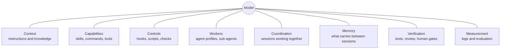



# AI harnesses

As of 2026-11-09.

Stop 3 on the talk path, about 3 minutes. [AI harnesses in detail]({{ '/sections/02-ai-harnesses/detail.html' | relative_url }}) covers each part in depth.

## What a harness is

A harness is the software around a model that gives it safe access to tools, memory and checks, set up to match one person's preferences, workflows and projects. Birgitta Böckeler of Thoughtworks put the 2026 usage this way: "harness has emerged as a shorthand to mean everything in an AI agent except the model itself".

Claude Code and Codex are harnesses already. Out of the box they give the model a loop, a set of tools, a permission system and a way to load instructions. Harness engineering is the work of extending that default for your own work: adding the rules, procedures, checks and helpers that make the agent do things your way, and stopping it from doing things you never want.

## The parts of a harness

Each part answers one question about the agent.

- Context: what does it know when it starts? Context files and templates ([Context files]({{ '/sections/04-context-files/' | relative_url }}), [Templates, prompt stubs and injected prompts]({{ '/sections/07-templates-and-stubs/' | relative_url }})).
- Capabilities: what can it do? Skills, commands, plugins and tools ([Skills, commands and plugins]({{ '/sections/05-skills-and-plugins/' | relative_url }})).
- Controls: what is it stopped from doing, whatever it decides? Hooks, scripts and checks ([Hooks, scripts and linters]({{ '/sections/06-hooks-scripts-and-linters/' | relative_url }})).
- Workers: who does the work? Agent profiles and sub-agents ([Agent profiles, sub-agents and delegation]({{ '/sections/08-delegation/' | relative_url }})).
- Coordination: how do several agents work together? ([Coordinating several sessions]({{ '/sections/09-session-coordination/' | relative_url }}), [Orchestration and workflows]({{ '/sections/10-orchestration/' | relative_url }})).
- Memory: what survives the end of a session? ([Context window and memory]({{ '/sections/11-context-window/' | relative_url }})).
- Verification: how do you know the work is right? ([Testing]({{ '/sections/12-testing/' | relative_url }}), [Code review]({{ '/sections/13-code-review/' | relative_url }}), [Human gates]({{ '/sections/14-human-gates/' | relative_url }})).
- Measurement: is the harness helping? ([Logging, observability and evaluation]({{ '/sections/16-logging-and-evaluation/' | relative_url }})).

Böckeler groups the same parts into guides, which steer the agent before it acts (context, templates, skills), and sensors, which give it feedback after it acts (tests, linters, review). See [deep dive: guides and sensors]({{ '/sections/02-ai-harnesses/detail.html' | relative_url }}#guides-and-sensors).

### Example: one task, every part

You ask an agent to add a field to an API. The context file tells it the project's conventions. A skill gives it your step-by-step procedure for API changes. A hook refuses its attempt to edit a generated file. A sub-agent writes the tests while the main agent writes the code. The tests and a reviewer from another model family check the result. You approve the merge. A log records what ran and what it cost. Take any one part away and you can name the mistake that would slip through.

## Instructions and enforcement

Some parts of a harness are instructions the model reads and interprets. Others are code that runs the same way every time. The difference matters more than anything else on this site. Claude Code's own docs call `CLAUDE.md` "context, not enforced configuration". An instruction is cheap to write and is followed most of the time. A check in code costs more to build and is followed every time. A good harness uses instructions for judgment calls and code for rules that must always hold. See [deep dive: soft and hard parts]({{ '/sections/02-ai-harnesses/detail.html' | relative_url }}#soft-and-hard-parts).

### Example: the same rule, soft and hard

"Run the tests before you commit" as a context-file line works until the agent is deep in a long task and forgets. The same rule as a commit hook that runs the tests and refuses the commit on failure cannot be forgotten.

## Systems thinking and reflexivity

Two ideas from [the story of the talk]({{ '/sections/00-landing-page/detail.html' | relative_url }}#the-story) shape how a harness grows.

Systems thinking treats the model, its instructions, its tools, its checks and the person directing it as one system. When an output is wrong, ask which part let it through, and fix that part. Blaming the model rarely helps; the model will make the same kind of mistake again.

Reflexivity is my word for a harness that improves itself from its own friction. A mistake that may happen again becomes a change to the harness, often made by an agent in the same session, so the next session starts with the fix.

### Example: from incident to guard

An agent on a shared machine stopped other people's test runs with a pattern kill, even though its instructions said not to. Systems thinking asks what let it through: the rule was written down, and nothing enforced it. Reflexivity turns that into a change: a hook now refuses pattern kills before they run and says how to stop one process instead. [Hooks, scripts and linters]({{ '/sections/06-hooks-scripts-and-linters/' | relative_url }}) tells the whole story.

## What a harness costs

Every part that loads into the context costs tokens on every turn. Research by HarnessTax (UC Berkeley and Arena, 2026) reported that across 21 model and harness pairs, the harness moved task success by about 2 to 5 points, while Claude Code cost about twice as much as a minimal four-tool harness on SWE-bench Lite (not yet verified against the primary source). The lesson is to add parts that fix a failure you have seen, and to measure whether they help.

## Pages for this topic

- [AI harnesses in detail]({{ '/sections/02-ai-harnesses/detail.html' | relative_url }}): definitions, each part with what it does and how to start, guides and sensors, soft and hard parts, the enforcement ladder, harness cost, and how to read a harness you did not build.


