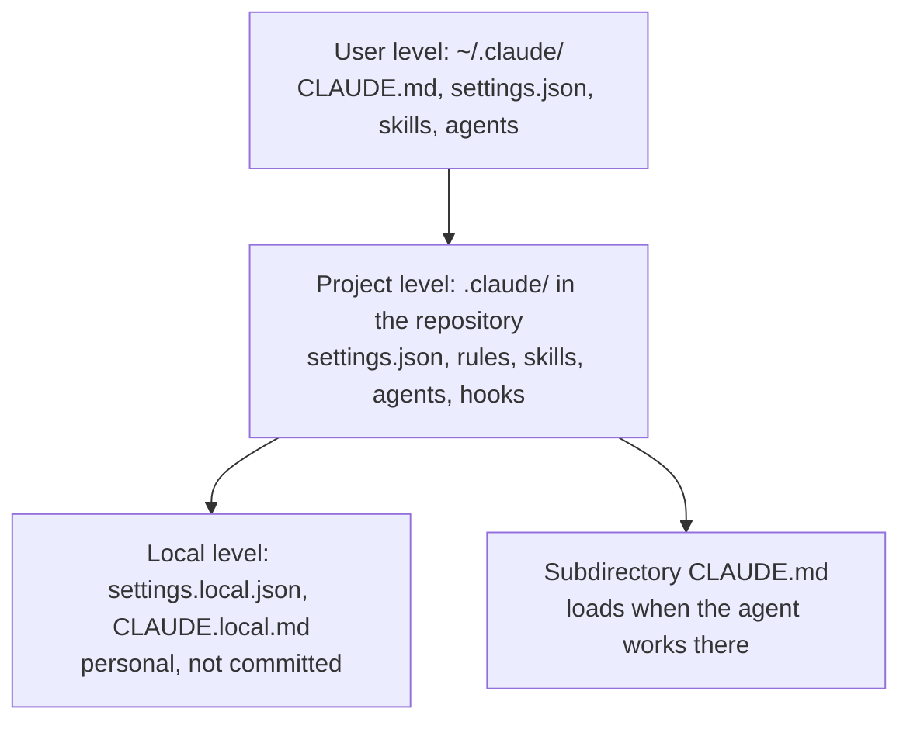
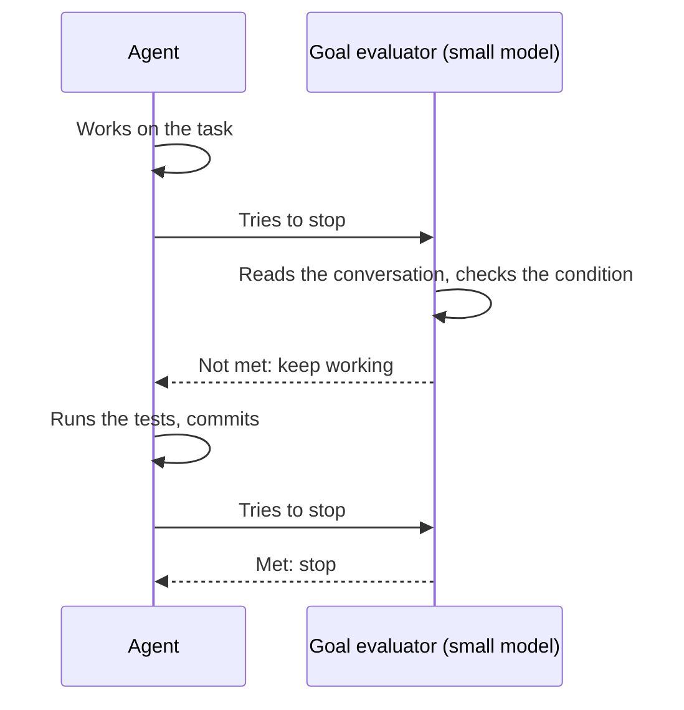
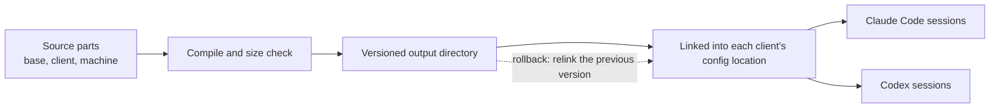



# Claude Code and Codex in detail

As of 2026-11-09.

This page covers what the two main clients provide before anything is customised: where they run, how their building blocks compare, where their configuration lives, the native commands grouped by what they are for, the Monitor tool, headless runs, and which features need which sign-in. The [section overview]({{ '/sections/03-claude-code-and-codex/' | relative_url }}) is the short version.

## Contents
{: .no_toc .text-delta }

1. TOC
{:toc}

## Surfaces

### Where they run

Claude Code and Codex are agents that work in a repository from the terminal. Both also run in editors and have desktop or web versions. Claude Code "runs the same underlying engine everywhere", and its configuration, project memory and MCP servers are shared across the local surfaces, so a setup built in the terminal also applies in the editor.

### Which surface to use

| Surface | Good for | Harness features |
|---|---|---|
| Terminal | Long tasks, several sessions side by side, scripting | All: context files, skills, hooks, sub-agents, commands |
| Editor extension | Work beside the code you are reading | Same engine and configuration as the terminal |
| Desktop and web | Starting work away from a terminal, reviewing results | Some features differ; a cloud session does not load local plugins |
| Headless (`claude -p`) | CI jobs and scripts | Skills and hooks run; terminal-only commands do not |

### Example: one setup, two surfaces

A `CLAUDE.md` and a hook written while working in the terminal take effect the next time you open the same project in the editor extension, because both read the same files.

## Building blocks compared

### Feature table

| Feature | Claude Code | Codex |
|---|---|---|
| Context file | `CLAUDE.md`, user, project and subdirectory levels | `AGENTS.md`, one per directory from root to working directory |
| Override file | Local `CLAUDE.local.md` | `AGENTS.override.md`, read first |
| Path-scoped rules | `.claude/rules/` with `paths:` frontmatter | not documented |
| Skills | `.claude/skills/<name>/SKILL.md`; person-only with `disable-model-invocation` | `.agents/skills`; `allow_implicit_invocation` controls model use |
| Hooks | 33 events; command, HTTP, MCP tool, prompt and agent handlers | 14 events |
| Sub-agents | Markdown with frontmatter in `.claude/agents/` | TOML in `.codex/agents/`, inheriting the sandbox |
| Goal command | `/goal` | `/goal` |
| Repeating prompt | `/loop` | none |
| Compaction | `/compact`, `/autocompact` | `/compact`, `model_auto_compact_token_limit` |
| Memory | Auto memory, `/memory` | `/memories` |
| Import another setup | none | `/import` reads Claude Code or Cursor setups |

### What the table hides

The two clients differ most in defaults and limits. Codex stops reading `AGENTS.md` files at 32 KiB in total by default; Claude Code's docs suggest keeping each `CLAUDE.md` under 200 lines. Claude Code reads `AGENTS.md` only when no `CLAUDE.md` exists in the working directory or above it, unless a setting changes that. A team that uses both clients can keep one `AGENTS.md` as the source and a short `CLAUDE.md` that imports it with `@AGENTS.md`.

### Example: one context file for both clients

```markdown
<!-- CLAUDE.md -->
@AGENTS.md

## Claude Code only
- Use the `/review` command before opening a pull request.
```

Codex reads `AGENTS.md` directly. Claude Code reads `CLAUDE.md`, which pulls in `AGENTS.md` through the `@` import and adds a few lines of its own.

## Configuration files

### Where things live in Claude Code



User-level files apply to every project. Project files are committed and shared with the team. Local files hold personal overrides that stay out of version control. More specific levels win when two settings conflict.

### settings.json

`settings.json` holds permissions, hooks, environment variables and the default model. A small example that allows the test command, asks before any push, and runs a formatter after every edit. A hook receives the tool call as JSON on standard input, so the command reads the edited file's path from it:

```json
{
  "permissions": {
    "allow": ["Bash(npm test:*)"],
    "ask": ["Bash(git push:*)"]
  },
  "hooks": {
    "PostToolUse": [
      {
        "matcher": "Edit|Write",
        "hooks": [{ "type": "command", "command": "jq -r '.tool_input.file_path' | xargs npx prettier --write" }]
      }
    ]
  }
}
```

`/update-config` edits this file from a plain request, and `/hooks` shows the hooks that are in effect and where each comes from.

## Native commands

Checked against Claude Code v2.1.319. Several commands changed meaning in recent releases: `/review` was a separate pull-request review before v2.1.223, `/simplify` was the bug-finding command before v2.1.147, and `/agents` lost its interactive manager after v2.1.197.

### Running long work

- `/goal <condition>` keeps the session working until a separate small model judges the condition met. It is a session-scoped prompt-based Stop hook; the evaluator has no tools and reads only the conversation, so the condition should name evidence the agent will print.
- `/loop` repeats a prompt on an interval or at a pace the agent sets itself; recurring tasks expire after 7 days.
- `/schedule` creates cloud scheduled tasks, which run without the machine or an open session.
- `/workflows` watches, pauses and saves dynamic workflows, the scripts Claude writes to run many sub-agents. A workflow starts when you ask for one or use the `ultracode` keyword. See [Orchestration and workflows]({{ '/sections/10-orchestration/' | relative_url }}).



### Splitting and tracking work

- `/tasks` lists the session's background work, including sub-agents that have finished. See [Agent profiles, sub-agents and delegation]({{ '/sections/08-delegation/' | relative_url }}).
- `/subtask` starts a sub-agent that inherits the conversation; `/fork` copies the session into a separate background session.
- `/background` detaches the session to run as a background agent; agent view (`claude agents`) watches every background session.
- `/batch` splits one large change into 5 to 30 units, each run by a background sub-agent in its own worktree.
- `/list-agents` lists the sub-agents and other sessions this session can message. See [Coordinating several sessions]({{ '/sections/09-session-coordination/' | relative_url }}).

### Context and session state

- `/context` shows what is filling the context window, by category, with suggestions. See [Context window and memory]({{ '/sections/11-context-window/' | relative_url }}).
- `/compact <focus>` summarises the session to free context, steered by the focus text. `/autocompact` sets how full the window gets before automatic compaction.
- `/clear` starts a new conversation with empty context; `/resume` returns to an earlier one.
- `/rewind` restores code, the conversation or both to a checkpoint. Files changed only by shell commands are not tracked, and sub-agent edits are usually not restored, so it does not replace git.
- `/branch` forks the conversation in place to try another direction; `/btw` asks a side question without adding it to the conversation.
- `/init` writes a starter `CLAUDE.md`; `/memory` edits `CLAUDE.md` files and auto memory.

### Configuration and enforcement

- `/hooks` shows every configured hook and where it comes from, read-only. See [Hooks, scripts and linters]({{ '/sections/06-hooks-scripts-and-linters/' | relative_url }}).
- `/permissions` sets allow, ask and deny rules; auto mode lets a classifier approve routine actions in long runs. See [Human gates, decisions and alignment]({{ '/sections/14-human-gates/' | relative_url }}).
- `/plan` and `/sandbox`: plan mode, and sandbox mode for shell commands.
- `/fewer-permission-prompts` scans transcripts for common read-only calls and proposes an allowlist; `/update-config` edits `settings.json` from a plain request.
- `/model` and `/effort` choose the model and the reasoning effort; `/advisor` lets a cheaper main model consult a stronger one at decision points.
- `/plugin`, `/reload-plugins`, `/reload-skills` and `/skills` manage plugins and skills without a restart; `/skill-doctor` shows what each skill costs in context and how often it is used.
- `/mcp` manages MCP connections; `/statusline` configures the status line.

### Review and verification

- `/code-review` (alias `/review`) reviews a branch, pull request, path or commit range in a separate context for bugs; `/security-review` checks the diff for security risks. See [Code review]({{ '/sections/13-code-review/' | relative_url }}).
- `/simplify` runs four review agents in parallel for cleanup.
- `/verify` builds and runs the app and observes the change working.
- `/deep-research` is the bundled research workflow.

### Measuring use

- `/insights` writes a report on your recent sessions, friction points included, for improving your setup. See [Logging, observability and evaluation]({{ '/sections/16-logging-and-evaluation/' | relative_url }}).
- `/usage` shows session cost and usage attribution.
- `/doctor` checks the setup and can audit instructions; `/debug` turns on debug logging for the session.

### Remote control

- `/rc` (`/remote-control`) controls a session from another device. It needs a claude.ai sign-in; API keys are not supported.

### Worked example: a morning's session

```text
> /context
  ⎿  System prompt and tools: 9%   Memory files: 4%   Messages: 12%   Free: 75%

> /goal the flaky test in tests/test_sync.py passes 20 runs in a row
  and the fix is committed

● Bash(for i in $(seq 20); do python -m pytest tests/test_sync.py -q || break; done)
  ⎿  ... 3 passed, then 1 failed: timeout waiting for lock

  ... (the agent finds a missing release in a cleanup path, fixes it,
       reruns 20 times, commits)

  ⎿  Goal met: 20 consecutive passes shown, commit a1b2c3d created.

> /compact keep the root cause and the commit id
```

`/context` shows the window has room, `/goal` holds the session to a checkable condition, and `/compact` frees space while keeping the two facts the next task needs. The percentages are illustrative.

## Monitor

### What it does

The Monitor tool watches a background command's output or a file path and feeds each new output line back to the agent as it arrives. The agent no longer has to poll. Monitors stop when the session ends.

### When to use it

- Waiting for a long build, test run or deploy, where you want the agent to react the moment a failure line appears.
- Following a log file during a live test.
- Watching a directory for a file another process will write.

### Trade-offs

Every line a monitor feeds back goes into the context. A monitor on a chatty log can fill the window with noise. Point it at filtered output, such as a `grep` for errors or a status file that changes rarely, and keep the full output in a file the agent reads only when needed.

### Example: waiting on a test run

```text
● Bash(python -m pytest tests -q > /tmp/run.log 2>&1; echo "EXIT $?" >> /tmp/run.log)
  run_in_background: true

● Monitor(command: tail -f /tmp/run.log | grep --line-buffered -E "FAILED|EXIT")
  ⎿  FAILED tests/test_sync.py::test_lock_release
  ⎿  EXIT 1
```

The agent starts the suite in the background, then monitors only the failure and exit lines. It sees the failure as soon as it is printed and can start reading the failing test while the rest of the suite finishes.

## Headless runs

### claude -p

`claude -p "<prompt>"` runs one task without the interactive terminal and prints the result. User-invoked skills work in this mode; terminal-only built-in commands such as `/login` do not.

### Reproducible runs with --bare

`--bare` skips hooks, skills, plugins and `CLAUDE.md`, so a CI job runs the same way on every machine whatever is installed there. Use it when you want the model and the prompt alone, such as a nightly evaluation run.

### Example: a CI job

```yaml
- name: Summarise the failing tests
  run: claude -p --bare "Read test-results.xml and list each failing test with a one-line cause" > summary.txt
```

## Availability on cloud providers

For Amazon Bedrock and similar cloud providers:

| Command or feature | On cloud providers |
|---|---|
| Dynamic workflows, `/workflows` | Available |
| `/goal` | Available; the evaluator runs on the session's provider |
| Auto mode | Available with supported models |
| Same-machine session messaging, `/list-agents` | Available from v2.1.248 |
| Cross-machine and cloud session messaging | Not available; needs Remote Control |
| `/remote-control` (`/rc`) | Not available, and API keys are not supported either |
| `/advisor` | Not available; Anthropic API only |
| `/code-review ultra` | Not available; falls back to a local review |
| `/insights` | Available |
| `/deep-research` | Needs the WebSearch tool; whether WebSearch exists on cloud providers is unverified |
| Claude in Chrome, computer use | Not available; need a direct Anthropic plan |

Whether `/loop` needs a sign-in is unverified. Unverified as well: if you have a skill of your own named `review`, the docs do not say whether `/review` runs your skill or the built-in review.

## Examples from my own harness

### One install for every machine

I work on several machines. One install step puts the same context files, skills, hooks and agent profiles on each of them, so a new session on any machine starts with the same setup. The shared context file is assembled from parts (a base, a part per client, a part per machine), rendered into a versioned directory and linked into place, so a bad edit can be rolled back to the previous version in one step.



To start: one context file in one repository. Add an install step when you have two machines or two repositories that should share it.

### Codex as a second family

My harness drives most work from Claude Code and calls Codex through a small wrapper with one configuration per role (reviewer, researcher, implementer). The main use is review: a change written by one model family is reviewed by the other, which does not share its blind spots. See [Code review]({{ '/sections/13-code-review/' | relative_url }}).

## Pitfalls and lessons

- Turning on many features at once makes a failure hard to trace. Add one piece at a time.
- Command names and meanings change between releases. Check the commands reference for your installed version before you script against a command.
- A feature that needs a claude.ai sign-in silently does not exist for someone on a cloud provider. Say which route a procedure assumes.

## Sources

- Commands reference and the features listed: <https://code.claude.com/docs/en/commands.md>, <https://code.claude.com/docs/en/workflows.md>, <https://code.claude.com/docs/en/goal.md>, <https://code.claude.com/docs/en/permission-modes.md>, <https://code.claude.com/docs/en/advisor.md>, <https://code.claude.com/docs/en/costs.md>, <https://code.claude.com/docs/en/code-review-local.md>, <https://code.claude.com/docs/en/cross-session-messaging.md>, <https://code.claude.com/docs/en/remote-control.md>, all verified 2026-11-09.
- `/loop`: <https://code.claude.com/docs/en/scheduled-tasks.md>, verified 2026-11-08.
- `/compact` and compaction: <https://code.claude.com/docs/en/context-window.md>, verified 2026-11-08.
- Surfaces and shared configuration: <https://code.claude.com/docs/en/platforms.md>, verified 2026-11-08.
- Context file loading and the 200-line suggestion: <https://code.claude.com/docs/en/memory.md>, verified 2026-11-08.
- Monitor tool and background commands: <https://code.claude.com/docs/en/tools-reference>, verified 2026-11-02.
- `/rewind` and its limits: <https://code.claude.com/docs/en/checkpointing.md>, verified 2026-11-09.
- Headless mode and `--bare`: <https://code.claude.com/docs/en/headless.md>, verified 2026-11-09.
- Claude in Chrome and computer use: <https://code.claude.com/docs/en/chrome.md>, <https://code.claude.com/docs/en/computer-use.md>, verified 2026-11-08.
- Codex commands, hooks, sub-agents, skills and `AGENTS.md`: <https://learn.chatgpt.com/docs/developer-commands.md?surface=cli>, <https://learn.chatgpt.com/docs/hooks.md>, <https://learn.chatgpt.com/docs/agent-configuration/subagents.md>, <https://learn.chatgpt.com/docs/build-skills.md>, <https://learn.chatgpt.com/docs/agent-configuration/agents-md>, verified 2026-11-08.
- The example settings, CI step and session excerpts are illustrations written for this page.


