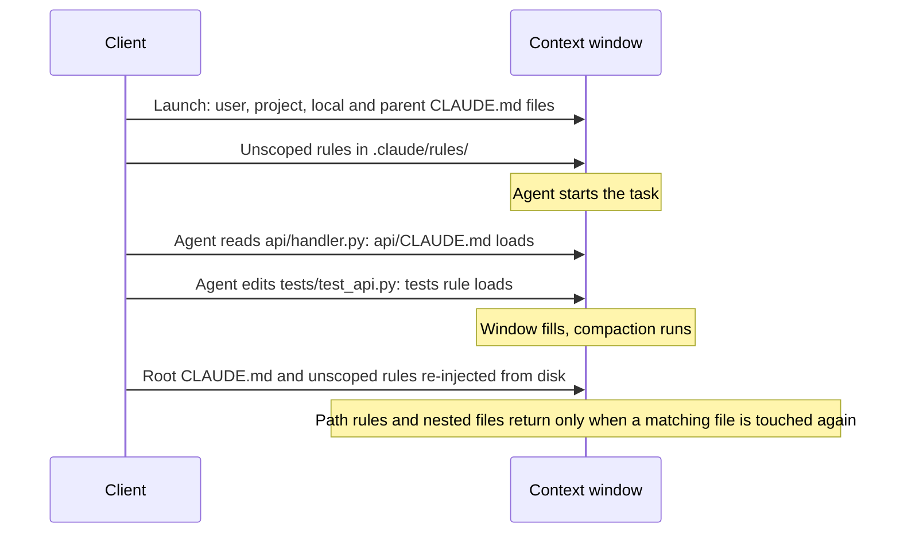
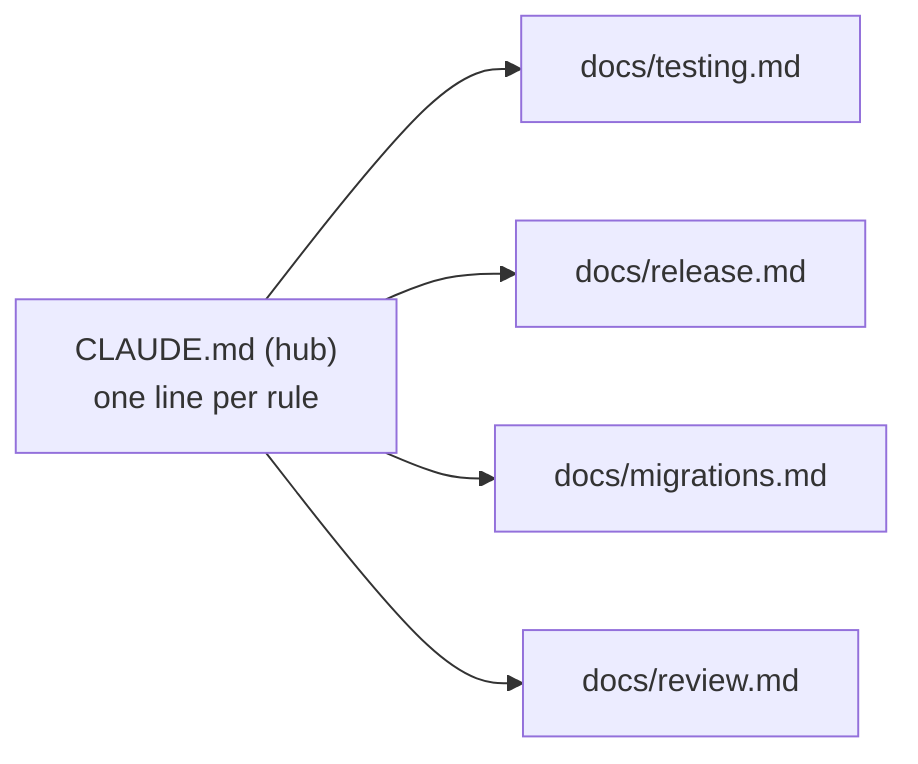
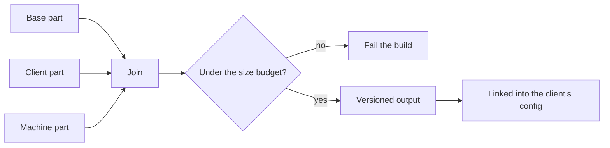



# Context files in detail

As of 2026-11-09.

This page explains how context files load in Claude Code and Codex, how to write rules that get followed, how to keep the always-loaded part small, and how to stop the files going stale. The [section overview]({{ '/sections/04-context-files/' | relative_url }}) is the short version.

## Contents
{: .no_toc .text-delta }

1. TOC
{:toc}

## How Claude Code loads context

### The levels

| Level | Location | Applies to | Loads |
|---|---|---|---|
| User | `~/.claude/CLAUDE.md` | Every project on the machine | At launch |
| Project | `CLAUDE.md` at the repository root, or `.claude/CLAUDE.md` | One repository, shared with the team | At launch |
| Local | `CLAUDE.local.md` | One repository, one person, not committed | At launch |
| Parent directories | `CLAUDE.md` in any directory above the working directory | Work started below them | At launch |
| Subdirectory | `CLAUDE.md` in a folder below the working directory | Work in that folder | When the agent reads or edits a file there |
| Path rule | `.claude/rules/*.md` with `paths:` | Matching files only | When a file tool touches a matching path |

### Load sequence in one session



### Imports

A context file can import another with `@path` syntax, up to four levels deep. Imports let one file pull in shared rules without copying them:

```markdown
@docs/conventions.md
@~/.claude/my-preferences.md
```

### After compaction

When the window fills and the history is summarised, Claude Code re-injects the project-root `CLAUDE.md` and unscoped rules from disk. Path-scoped rules and nested files are summarised away until the agent touches a matching file again. A rule that must survive compaction belongs in the root file or an unscoped rule.

### Example: why a rule disappeared

A rule in `api/CLAUDE.md` says "every handler returns a typed error". The agent follows it all morning. After a compaction, it writes a new handler in a file it creates with a shell command, without reading any existing file in `api/`. The nested file never loads again, and the new handler returns a plain string. Fix: move the rule to a path rule on `api/**`, which loads when any file tool touches the new file, or to the root file if it is short.

## How Codex loads AGENTS.md

### The walk

Codex walks from the project root to the working directory and reads one `AGENTS.md` per directory. In each directory it checks `AGENTS.override.md` first. It stops at 32 KiB in total by default; the `project_doc_max_bytes` setting changes the cap.

### Using both clients

Claude Code reads `AGENTS.md` only when no `CLAUDE.md` exists in the working directory or above it, unless a setting changes that. A repository used with both clients can keep `AGENTS.md` as the main file and a two-line `CLAUDE.md` that imports it:

```markdown
@AGENTS.md
- Claude Code only: run /code-review before opening a pull request.
```

## Writing rules that get followed

### What belongs in a context file

- Commands the agent cannot guess: build, test, lint, run one test, start the app.
- Conventions that differ from the language default.
- Things never to do, with the reason and the right alternative.
- Corrections you have had to give more than once.

### What does not

- Long procedures. Link to them instead (see [Hub and spoke](#hub-and-spoke)).
- Facts the agent can read from the code, such as the directory layout.
- Rules that must hold every time. State them here, and enforce them in a hook or check.

### How to phrase a rule

A rule the agent can act on names the action, the condition and the alternative. Compare:

| Weak | Strong |
|---|---|
| Be careful with the database. | Never run migrations against production. Use `make migrate-staging`. |
| Write good tests. | Every bug fix starts with a failing test that reproduces the bug. |
| Don't break the build. | Run `make check` before every commit; it must pass. |

### Example: turning a correction into a rule

You correct the agent twice in a week for running the full end-to-end suite, which takes forty minutes, when one test would do. Add: "Run one test with `pytest -k <name>`. Run the full suite only before a push." The third time does not happen.

## Hub and spoke

### The pattern



The context file holds one line per rule with a link to a procedure document that holds the detail. The agent reads the procedure when a task needs it. The always-loaded part stays small, and the detail is still one read away.

### Making the link work

The agent has to know when to follow a link. Put the trigger in the line: "Before any release, read docs/release.md." A bare list of links gets ignored.

### Trade-off

Linking out moves the size problem into the procedures. A procedure that grows to thousands of lines is no easier to follow than a long context file. Give each procedure a size budget too, and split it when it grows.

## Path-scoped rules

### How they work

A path rule is a Markdown file in `.claude/rules/` with a `paths:` list of globs in its frontmatter. It loads only when a file tool reads or edits a matching file. A rule with no `paths:` loads at launch like a context file.

```markdown
---
paths: ["docs/**/*.md"]
---
- Every new page gets a "Sources" section with a verification date per source.
- No em dashes; use a comma or a full stop.
```

### When to use them

Use a path rule when the rule applies to one kind of file: tests, docs, migrations, infrastructure. It keeps those rules out of the context during unrelated work.

### Limits

Path rules load only when a file tool touches a matching path. An agent that works only through shell commands (writing a file with `cat > file`, for example) never sees them. If agents in your setup do much of their work through the shell, back the important path rules with a hook.

## Examples from my own harness

### Three layers of context

My context has three layers: one file shared by all my projects, one file per repository, and a section for each machine I work on (paths, installed tools, what works and what does not on that machine). Every session on every machine gets the shared rules; each repository adds its own; each machine adds its traps.

### A compiled shared file

The shared file is assembled from smaller source parts by a script: a base part, a client-specific part (Claude Code or Codex) and a machine part. The script joins them, checks the result against a size budget, and fails if it is over. The installer renders the result into a versioned directory and links it into each client's configuration location, so a bad edit can be rolled back by relinking the previous version.



The size check matters more than the join. Without it, the shared file grew every time a lesson was added.

### Procedures as spokes

Each procedure document is named by one line in the shared file, with the trigger for reading it. Path-scoped rules cover tests, documentation and skill authoring, so those rules appear only when an agent works on those files.

To start: one hand-written `CLAUDE.md` per repository. Add a user-level file when you notice the same lines in every repository.

## Keeping context files current

### Staleness

Context files go stale when the mechanisms they describe change. A file that still describes a retired script or an old test command sends every session the wrong way. Sweep them like code: when you change a mechanism, update the line that describes it in the same commit.

### Size

Context files grow faster than they are pruned. Review the always-loaded file now and then, and for each line ask whether a recent session needed it. Move detail into spokes; delete lines for problems newer models no longer have.

### Example: reflexivity in a context file

When an agent repeats a mistake after a correction, the harness is updated in the same session so the next session starts with the fix. A context-file line is the cheapest update. When the mistake can be detected in code, a hook or check is the stronger one (see [Hooks, scripts and linters]({{ '/sections/06-hooks-scripts-and-linters/' | relative_url }})).

## Pitfalls and lessons

- A long file gets followed less reliably, and every line costs context on every turn.
- Linking out moves the size problem into the procedures. Budget those too.
- Path-scoped rules never load in shell-only work.
- Context files go stale. Update them in the same change as the mechanism they describe.
- A context file is an instruction the model interprets. Back must-hold rules with code.

## Sources

- Claude Code loading order, levels, imports, `AGENTS.md` behaviour, path rules and the 200-line suggestion: <https://code.claude.com/docs/en/memory.md>, verified 2026-11-08.
- Path rules and nested files after compaction: <https://code.claude.com/docs/en/context-window.md>, verified 2026-11-09.
- `/init` and `/memory`: <https://code.claude.com/docs/en/commands.md>, verified 2026-11-09.
- Codex `AGENTS.md`, overrides and the 32 KiB cap: <https://learn.chatgpt.com/docs/agent-configuration/agents-md>, verified 2026-11-08.
- The three layers and the compiled file are from the author's own harness, described conceptually. The example files are illustrations written for this page.


