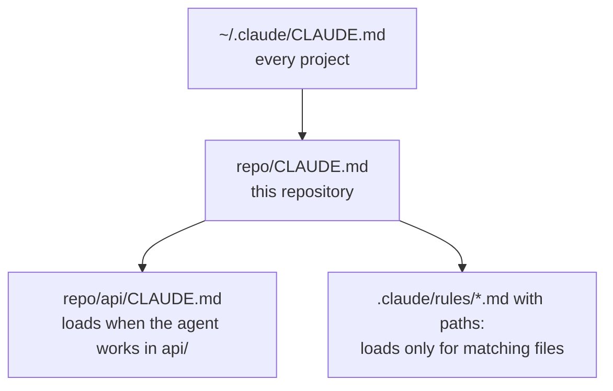



# Context files

As of 2026-11-09.

Stop 4 on the talk path, about 1.5 minutes. [Context files in detail]({{ '/sections/04-context-files/detail.html' | relative_url }}) covers loading rules, imports, path rules, Codex's differences and how to keep the files current.

## What a context file is

A context file is a plain Markdown file of instructions that the client loads into the model's context. Claude Code reads `CLAUDE.md`; Codex and several other tools read `AGENTS.md`. Whatever you write there, the agent sees at the start of every session: how to build and test the project, the conventions to follow, the commands to avoid, the mistakes you have corrected before.

It is the cheapest part of a harness to write and the first one to add. `/init` in Claude Code writes a starter file from the repository, and `/memory` opens the files for editing.

### Example: a first CLAUDE.md

```markdown
# Project notes

- Build: `make build`. Test: `make test`. Run one test: `pytest -k <name>`.
- Python 3.12, formatted with ruff. Never edit files under `generated/`; run `make gen`.
- Every bug fix starts with a failing test that reproduces it.
- Database migrations must have a down step.
```

Four lines save the agent from guessing the test command, editing generated code, or fixing a bug without a test.

## How they load

Context files are hierarchical. In Claude Code, a user-level file applies to every project, a project file applies to one repository, and a file in a subdirectory loads when the agent reads or edits a file there. Files in the directories above the working directory load at launch.



Path-scoped rules go one step further. A rule file in `.claude/rules/` with a `paths:` list in its frontmatter loads only when the agent touches a matching file, so the rules for test files appear only when the agent works on tests. See [deep dive: loading]({{ '/sections/04-context-files/detail.html' | relative_url }}#how-claude-code-loads-context).

### Example: a rule for tests only

```markdown
---
paths: ["tests/**/*.py"]
---
- Test through the public entry point, never a private helper.
- Name tests test_<given>_<when>_<then>.
```

## Keep the always-loaded file short

Everything in an always-loaded file costs context on every turn, and a long file gets followed less reliably. Claude Code's docs suggest keeping each `CLAUDE.md` under 200 lines. The pattern that keeps it short is hub and spoke: the context file holds one line per rule with a link to a procedure document that holds the detail. The agent reads the procedure when a task needs it.

### Example: hub and spoke

```markdown
- Releases: tag from main only, after the full suite passes. Procedure: docs/release.md
```

One line tells the agent the rule and where to find the steps. The twenty-step release procedure stays out of the context until someone releases.

## Context files are instructions

A context file is read and interpreted, which means it is followed most of the time. Claude Code's docs call `CLAUDE.md` "context, not enforced configuration". When a rule must hold every time, put it in a hook or a check as well (see [Hooks, scripts and linters]({{ '/sections/06-hooks-scripts-and-linters/' | relative_url }})).

## Pages for this topic

- [Context files in detail]({{ '/sections/04-context-files/detail.html' | relative_url }}): loading order, imports, path rules and compaction, Codex `AGENTS.md`, writing good rules, hub and spoke, a compiled shared file, keeping files current, and pitfalls.


