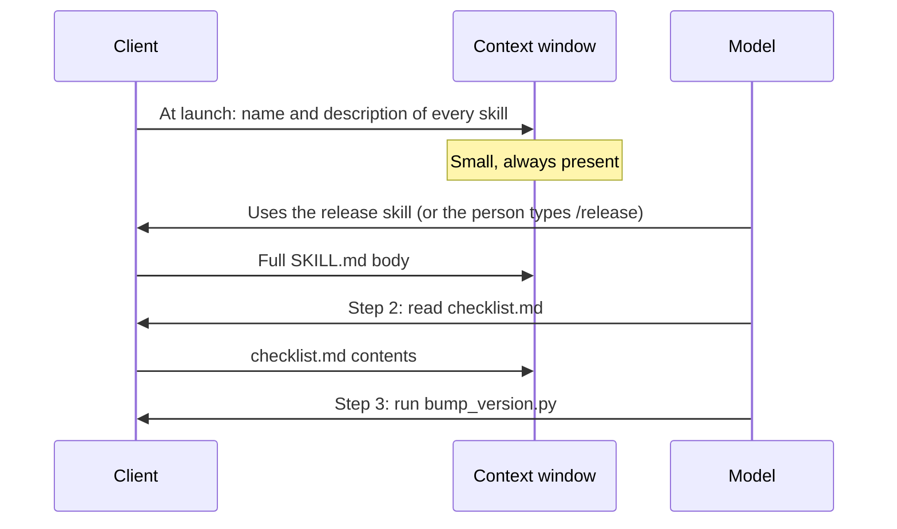
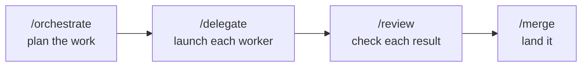
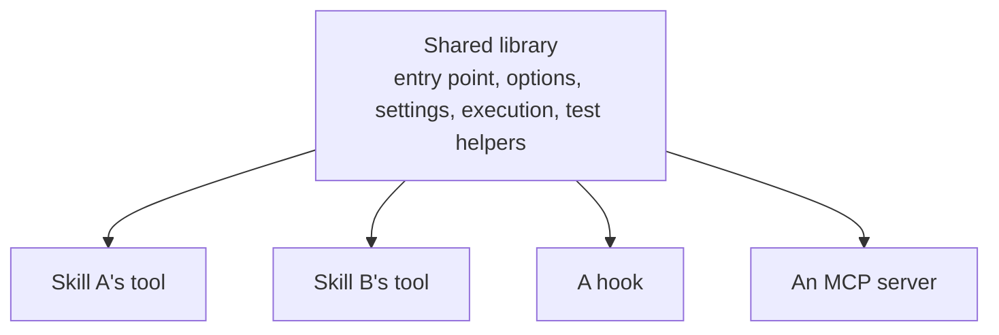



# Skills and plugins in detail

As of 2026-11-09.

This page covers skills, plugins and mods: the file format, how loading works, who can start a skill, how to chain skills, how plugins package parts, and how to keep a growing set of skills useful. The [section overview]({{ '/sections/05-skills-and-plugins/' | relative_url }}) is the short version.

## Contents
{: .no_toc .text-delta }

1. TOC
{:toc}

## Skills

### The format

A skill is a folder. The only required file is `SKILL.md`: YAML frontmatter with a name and a description, then instructions in Markdown. The folder can hold scripts the instructions tell the agent to run, templates, and reference files the agent reads only when a step needs them.

```text
.claude/skills/<name>/    # here <name> is release
├── SKILL.md           # frontmatter + steps
├── checklist.md       # read at step 2
└── bump_version.py    # run at step 3
```

Skills live at the user level (`~/.claude/skills/`), the project level (`.claude/skills/`) or inside a plugin. In Claude Code, custom commands have been merged into skills, so `/release` starts the skill named `release`.

### How loading works



Only the description is always loaded. The body, and any file it references, loads when needed. A skill set can be large without filling the window, as long as the descriptions are short.

### The Agent Skills standard

Skills follow the Agent Skills open standard, which Codex also uses (Codex looks in `.agents/skills`). Anthropic gave the standard to the Agentic AI Foundation in October 2026. A skill written for one client usually works in the other with small changes.

### Example: a procedure as a skill

A team writes the same pull request description by hand every time: summary, linked issue, test evidence, rollout notes. As a skill:

```markdown
---
name: pr-description
description: Write a pull request description for the current branch. Use when the user asks for a PR description or before opening a pull request.
---
1. Run `git log --oneline main..HEAD` and `git diff --stat main...HEAD`.
2. Write: Summary (two sentences), Linked issue, Changes (one line per file group),
   Test evidence (the exact test command and its last line of output), Rollout notes.
3. Never claim a test passed unless its output is in this session.
```

Step 3 is a rule the team learned from an agent that reported passing tests it had not run.

## Who can start a skill

### The settings

| Frontmatter | Person can start | Model can start | Use for |
|---|---|---|---|
| (default) | Yes | Yes | Procedures the model should use whenever they fit |
| `disable-model-invocation: true` | Yes | No | Side effects the person must choose: publish, send, merge, delete |
| `user-invocable: false` | No | Yes | Background procedures that should never clutter the command menu |

Codex has a similar setting, `allow_implicit_invocation: false`.

### Choosing

Let the model start skills it should use whenever the situation fits, such as a test procedure or a review checklist. Make a skill person-only when running it is a decision only you should make.

### A trap

A person-only skill cannot be started by another skill, a hook or an agent's brief. If any of those call it, the chain breaks silently: the agent reads "now run the publish skill" and cannot. Keep a skill model-invocable if anything else in your harness calls it, and put the gate inside it instead (a confirmation step, or a hook on the dangerous command).

### Example: two skills, two settings

`/pull-latest` updates the local checkout from the remote and can overwrite local work; it is person-only. `/run-tests` runs the project's test procedure; the model starts it after every change. Both are skills, and the setting follows from who should decide.

## Writing good descriptions

### Why they matter

The model chooses a skill from its description. A vague description means the skill is never used; an overlapping one means the wrong skill is used.

### What a good one says

- What the skill does, in one sentence.
- When to use it, with the words a person would use ("Use when the user asks for a PR description").
- When not to use it, if a neighbouring skill is close.

### Example: fixing an overlap

Two skills, `review` ("Review code") and `audit` ("Audit code for problems"), get picked at random. Rewritten: `review` "Review the current diff before a commit or pull request"; `audit` "Audit a whole module for design problems; use only when the user asks for an audit". The model now picks correctly.

## Chaining skills

### Several skills in one message

Claude Code lets a person start one message with several skills, up to six: typing `/skill-a /skill-b do XYZ` loads both skills before the task.

### A skill that calls a skill

A skill's instructions can tell the agent to run another skill at a step. That second form is a convention; the docs do not describe it. It works because the agent reads "run `/delegate` with this brief" as an instruction and starts that skill.



### Example: one launch path

My orchestration skill plans a piece of work and then hands each launch to my delegation skill, which renders the brief and starts the worker in its own worktree. Because every launch goes through one skill, a fix to how briefs are rendered lands once and applies to every launch.

## Plugins

### What a plugin is

A plugin is "a directory of skills, agents, hooks, MCP servers, or other components that Claude Code installs and loads as one unit". The docs say to use one "when you want several skills, subagents, hooks, or MCP servers packaged as one unit". Plugins are installed from a marketplace, which is a catalogue you can host yourself.

```text
my-plugin/
├── .claude-plugin/plugin.json
├── skills/<name>/SKILL.md
├── agents/security-reviewer.md
├── hooks/hooks.json
└── .mcp.json
```

### Managing plugins

`/plugin` lists, installs, enables and disables plugins; `/reload-plugins` applies changes without a restart. The same plugin format installs on claude.ai and in Cowork, where a different set of components loads, and a cloud session does not load local plugins.

### Cost

Every enabled plugin costs context on every turn, because the name and description of each model-invocable skill and agent stay loaded. `/skill-doctor` shows what each skill costs in context and how often it is used.

### Mods

A mod is a plugin with a hooks module: hooks written as JavaScript or TypeScript functions. Mods change how Claude Code looks and behaves, such as drawing panes in the terminal. Mods need Claude Code 2.1.287 or later.

## Shared code across skills

### The problem

Skills often include small command-line tools. Written one per skill, each parses options its own way, loads settings its own way and has its own test helpers. A bug fixed in one stays in the others.

### Plugin modules

One useful pattern is a plugin whose skills, MCP servers and hooks all reuse one shared code library, so the code is written once and is not copied into each skill. I call this a plugin module. That is my informal name; Claude Code has no such term. The nearest vendor term is a "hooks module", described above.



### Example: the layout

In my harness the shared library for skill tools has one module each for the entry point, options, settings, execution and test helpers. Each skill's tool imports it, so they parse options and load settings the same way, and a fix lands once for all of them.

## Examples from my own harness

- Person-only skills for actions with side effects, such as pulling from git or filing feedback. A skill that another skill or a hook calls stays model-invocable, or the chain breaks.
- Chained skills: the orchestration skill hands its launch step to the delegation skill, as shown above.
- A shared library for the command-line tools inside skills, as shown above.
- A core plugin that serves the same read-only tools to Claude Code and to Codex, so both clients query the same knowledge store the same way.
- Mods that draw status panes inside the terminal session, such as a pane showing how full the context window is.

To start: turn the prompt you type most often into a skill.

## Managing a growing set

### Pruning

Skills pile up. Look at which skills were used in the last month, and delete or merge the ones nobody invokes. `/skill-doctor` and `/insights` help.

### Testing

A skill is code in prose. Test the parts that can be tested: a skill's scripts have unit tests, and a test can check each `SKILL.md` has valid frontmatter and that every person-only skill is not called by another skill.

### Rules that must hold

A skill body loads only on use. A rule that must always hold does not belong only in a skill; put it in the context file or in a hook.

## Pitfalls and lessons

- Skills with overlapping descriptions make the model pick the wrong one.
- A person-only skill called by another part of the harness breaks the chain without an error.
- Every enabled plugin costs context. Disable what you do not use.
- Skills pile up. Delete the ones nobody invokes.

## Sources

- Skills, the file format and invocation settings: <https://code.claude.com/docs/en/skills.md>, verified 2026-11-09.
- Several skills in one message, up to six; `/plugin`, `/reload-plugins`, `/skill-doctor`: <https://code.claude.com/docs/en/commands.md>, verified 2026-11-09.
- Plugins, the hooks module and mods: <https://code.claude.com/docs/en/plugins/overview.md> and <https://code.claude.com/docs/en/plugins/mods/overview.md>, verified 2026-11-08.
- Agent Skills donation: <https://www.anthropic.com/news/donating-agent-skills-to-the-agentic-ai-foundation>, verified 2026-11-08.
- Codex skills: <https://learn.chatgpt.com/docs/build-skills.md>, verified 2026-11-08.
- The shared library, chained launch path and core plugin are from the author's own harness, described conceptually. The example skills are illustrations written for this page.


