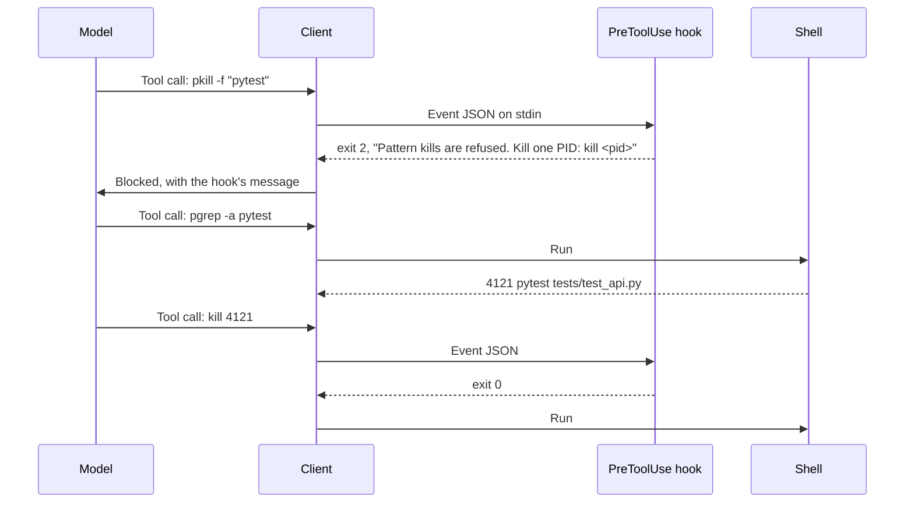
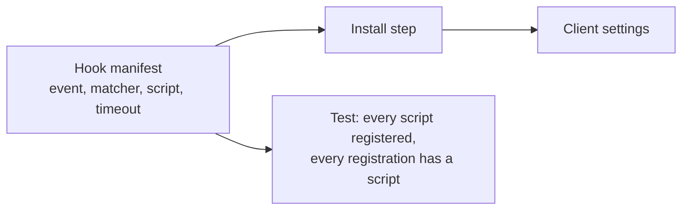



# Hooks and scripts in detail

As of 2026-11-09.

This page covers deterministic controls: code that runs at fixed points whether or not the model remembers the rule. It goes through the enforcement ladder, hook events and handlers, how to write a guard that agents can work with, git hooks and CI gates, linters, the guards in my own harness, and what all of this costs. The [section overview]({{ '/sections/06-hooks-scripts-and-linters/' | relative_url }}) is the short version.

## Contents
{: .no_toc .text-delta }

1. TOC
{:toc}

## Why enforce in code

### Instructions drift

An agent follows a context-file instruction inconsistently over time: more so as its context fills, when it juggles several tasks, and when it switches away and forgets to come back. The instruction may also be missing from the context at the moment it matters, after a compaction or in a sub-agent whose brief left it out.

### Code does not

A hook or check runs at a fixed point, every time, with the same result for the same input. It does not depend on what the model remembers. Claude Code's docs draw the same line: `CLAUDE.md` is "context, not enforced configuration", and when Claude skips a rule that must hold every time, the skills guide says to move it into a hook.

## The enforcement ladder

### The five steps

| Step | Mechanism | Fits | Checked | Weakness |
|---|---|---|---|---|
| 1 | Context rule | Preferences and judgment calls no program can check | Never; the model reads it | Least consistently followed |
| 2 | Path rule | The same, for some files only | Never | Loads only when a file tool touches a match |
| 3 | Skill | Procedures with fixed steps | When it runs | Nothing forces it to run |
| 4 | Hook or guard | An action that must always or never happen | At the moment the agent acts | Can block legitimate work |
| 5 | Test or CI gate | A property of the result | At commit, push or merge | Later and slower |

### Moving a rule up

Start a rule at the lowest step that works. When agents keep breaking it, move it up to the next step that can enforce it. Keep the lower step too: the context line explains why, and the hook enforces it.

### Example: one rule, three steps

"Never run the full end-to-end suite on a shared machine without the shared test lock." Step 1: a context line. Agents still forgot under load. Step 4: a hook on the shell tool that refuses the suite command unless it is wrapped in the lock command, and prints the wrapped form. The context line stays, so the agent knows why before it is refused.

## Hooks

### Events

A hook is a handler the client runs at a lifecycle event. Claude Code's hooks reference lists 33 events; Codex has 14. The ones a harness uses most:

| Event | When it fires | Typical use |
|---|---|---|
| `PreToolUse` | Before a tool call runs | Refuse dangerous commands; check paths |
| `PostToolUse` | After a tool call | Format edited files; record what changed |
| `UserPromptSubmit` | When a prompt is submitted | Add context; check the prompt |
| `SessionStart` | At session start or resume | Load state; print reminders |
| `PreCompact` | Before compaction | Save state the summary might lose |
| `Stop` | When the agent tries to finish | Refuse to stop until a condition holds |
| `SubagentStop` | When a sub-agent finishes | Check its result |

### Handler types

A hook can be a shell command, an HTTP call, an MCP tool call, a prompt to a model or an agent. Command hooks are the most common: the client passes the event as JSON on standard input and reads the exit code and output.

### Exit codes and messages

In Claude Code, exit code 0 lets the action proceed. Exit code 2 means "stop, don't do this": the action is blocked and the hook's standard error goes back to the agent as feedback. A hook after a tool call cannot undo it, because the tool already ran; it can only report.



### Registering a hook

```json
{
  "hooks": {
    "PreToolUse": [
      {
        "matcher": "Bash",
        "hooks": [{ "type": "command", "command": ".claude/guards/no-pattern-kill.sh", "timeout": 5 }]
      }
    ]
  }
}
```

The matcher picks which tool the hook sees. The timeout keeps a hung hook from blocking every call.

## Writing a guard

### Say how to fix it

A refusal message that says exactly how to fix the problem gets a correct second attempt. "Refused" alone gets a retry of the same thing, or a workaround that dodges the guard.

| Weak refusal | Strong refusal |
|---|---|
| `Blocked.` | `Pattern kills are refused on shared machines. Find the PID with pgrep -a <name> and run kill <pid>, or kill your own process group with kill -- -<pgid>.` |

### Refuse what you cannot prove safe

A guard that parses shell commands will meet commands it cannot fully parse: loops, variables, substitutions. Refusing those is the safe default, at the cost of refusing some safe commands. Say so in the message, and suggest the plain form that the guard can read.

### Gate the step on the check

A check protects you only if the risky step cannot run after the check fails. When the check and the risky step are separate lines in a script, the step still runs after a failed check.

```bash
# Wrong: the add runs whatever the check said
python check_conflicts.py merged.jsonl
git add merged.jsonl

# Right: the add is unreachable when the check fails
python check_conflicts.py merged.jsonl && git add merged.jsonl
```

That is how conflict markers reach a repository with every exit code green: the check refused correctly, and the next line staged the file anyway.

### Use the tool that already exists

Before writing a new check, search the repository for a tool that already enforces the rule, using the names the code uses. A new script that repeats an existing check loses the cases the old one learned to handle.

### Example: a guard with a fix in its message

```bash
#!/usr/bin/env bash
# PreToolUse guard: refuse a pipe that hides a failed command's exit status
cmd=$(jq -r '.tool_input.command')
if [[ "$cmd" =~ (git\ push|git\ commit)[^|]*\|\ *(head|tail|grep) ]]; then
  cat >&2 <<'MSG'
A pipe reports only the last command's status, so a failed push would read as success.
Fix one of three ways:
  1. Run the command without the pipe.
  2. Add `set -o pipefail;` before it.
  3. Redirect output to a file and read the file in a second call.
MSG
  exit 2
fi
```

## Git hooks, CI gates and linters

### Git hooks

Git runs hooks at commit and push. A pre-commit hook can run the formatter, the linter and fast tests; a pre-push hook can run the slower tests that cover the changed files. They apply to agents and people alike, and an agent cannot skip them unless it passes `--no-verify`, which a tool-call hook can refuse.

### CI gates

A CI gate runs on the server after a push or before a merge. It is the last check and the slowest, and the only one that runs on a clean machine.

### Linters and ratchets

A linter checks code style and common mistakes. A ratchet is a check that lets a quality metric only improve: the number of lint warnings, untyped functions or long files may go down but never up. Ratchets let you adopt a strict rule in a large codebase without fixing everything first.

### Example: a ratchet

```text
$ make quality
lint warnings: 412 (baseline 415)  OK, baseline lowered to 412
untyped functions: 88 (baseline 88) OK
files over 800 lines: 13 (baseline 12)  FAIL: one more than the baseline
```

## Examples from my own harness

### Instructions that became guards

Each of these started as a written rule that agents broke.

| Guard | What happened before it | What it does now |
|---|---|---|
| Process-kill guard | The rule against killing processes by name pattern was in the brief when an agent ran `pkill -f` on a shared machine and stopped three unrelated test runs | Refuses pattern kills; says to kill one process id or process group |
| Shell-tracing guard | Shell tracing echoed API keys into the session | Refuses trace flags in commands |
| Evidence-citation guard | Committed documents kept citing evidence in ignored files that a cleanup would delete | Refuses an edit whose cited evidence path is not tracked in git |
| Wildcard-delete guard | A sub-agent deleted many of its launcher's files with a wildcard under a shared temporary directory | Refuses wildcard deletes under shared scratch locations |
| Pipe-status guard | A failed push and a failed issue filing were both reported as successes behind a pipe | Refuses the pipe and lists three fixes |

### Isolation and commit checks

A worktree guard stops a sub-agent from writing outside its own checkout, including running git against another directory. Commit and push checks run the formatter, the linter and the tests the diff touches, and one requires each commit to record which model and agent wrote it.

### One manifest

Hooks are registered from one manifest that an install step applies, so a hook is added or removed in one place and a test can check what is registered. The test fails if a hook file exists with no registration, or a registration names a missing file.



To start: turn the rule an agent has broken twice into a hook.

## Costs

### Blocking legitimate work

A guard that cannot prove a command safe refuses it, even when it is safe. In my harness the isolation guard has refused safe loops and commands built from variables because it could not prove they did not run git elsewhere. Each false refusal costs a retry and some context.

### Time and hangs

Every hook adds time to every call it checks. A hook that runs on every launch or tool call can block all work when it hangs. Give each hook a time limit and a visible failure.

### Tokens

Hooks that inject text add tokens on every call. A reminder injected before every shell command is read thousands of times. Scope injected text to the sessions it concerns, and print it only when it applies.

### Maintenance

Guards need maintenance as the harness changes. A guard that refuses a command the harness now relies on teaches agents to route around it.

## Pitfalls and lessons

- A refusal without a fix gets a retry or a workaround.
- A check and a risky step on separate lines protect nothing.
- A hook without a timeout can stop all work.
- An unpassable gate teaches people and agents to bypass it.
- Reflexivity example: several guards in my harness started as written rules that agents broke.

## Sources

- Claude Code hooks, events, exit code 2, handler types: <https://code.claude.com/docs/en/hooks.md>, verified 2026-11-09 (partial read of a long page).
- "context, not enforced configuration": <https://code.claude.com/docs/en/memory.md>, verified 2026-11-09.
- Moving a must-hold rule into a hook: <https://code.claude.com/docs/en/skills.md>, verified 2026-11-09.
- Codex hooks: <https://learn.chatgpt.com/docs/hooks.md>, verified 2026-11-08.
- The guards, the manifest and the isolation guard are from the author's own harness, described conceptually. The example scripts and settings are illustrations written for this page.


