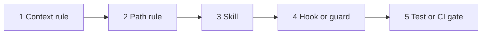
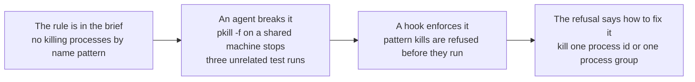



# Hooks, scripts and linters

As of 2026-11-09.

Stop 5 on the talk path, about 4 minutes. [Hooks and scripts in detail]({{ '/sections/06-hooks-scripts-and-linters/detail.html' | relative_url }}) covers hook events, handler types, exit codes, writing guards, and the guards in my own harness.

## Enforce as much as possible in code

An agent follows a written instruction most of the time. It follows it less as its context fills, when it juggles several tasks, and when it switches to something else and forgets to come back. A hook, script, linter, test or CI gate runs the same way every time. The working principle of this site is to enforce as much as possible in code, and rely on context-file instructions only where code cannot do the job.

## The enforcement ladder



1. Context rule: a line in `CLAUDE.md` or `AGENTS.md`. For preferences and judgment calls that no program can check. Cheapest, and least consistently followed.
2. Path rule: the same, for rules that apply only to some files.
3. Skill: a procedure with fixed steps, followed consistently when it runs. Nothing forces it to run.
4. Hook or guard: checked at the moment the agent tries an action. It runs every time and can refuse the action with a message that says how to fix it.
5. Test or CI gate: checks a property of the result at commit, push or merge. It catches what got past the earlier steps, later and more slowly.

Move a rule up a step when agents keep breaking it.

### Example: placing three rules

"Prefer small functions" is a judgment call: a context rule. "Never commit a file containing a secret" can be checked by a program: a commit hook with a secret scanner. "The release notes list every merged change" is a property of the result: a CI check that compares the notes with the merge log.

## What a hook is

A hook is a handler the client runs at a lifecycle event: before a tool call, after a tool call, at session start, before compaction, when the agent tries to stop, and more. Claude Code's hooks reference lists 33 events; Codex has 14. A hook before a tool call can block it. In Claude Code, exit code 2 means "stop, don't do this", and the hook's message goes back to the agent, which reads it and tries again. A hook after a tool call cannot undo it, because the tool already ran.

`/hooks` shows every configured hook and where it comes from, read-only.

### Example: a hook that blocks force pushes

```bash
#!/usr/bin/env bash
cmd=$(jq -r '.tool_input.command')
if [[ "$cmd" =~ git\ push.*(--force|-f\ ) ]]; then
  echo "Force push refused. Push to a new branch and open a pull request instead." >&2
  exit 2
fi
```

Registered on the shell tool's pre-call event, it reads the command the agent wants to run and refuses a force push with a message that tells the agent what to do.

## Case study: the process-kill guard



The rule against killing processes by name pattern was already in the agent's brief. An agent ran `pkill -f` on a shared machine anyway, and three test runs that belonged to other sessions stopped. Writing the rule more firmly would not have helped; it was already there. The fix was a hook that refuses any pattern kill before it runs and tells the agent to kill one process id or one process group instead. The agent reads the refusal, finds the right process id, and kills only that.

## What guards cost

A guard that cannot prove a command safe refuses it, even when it is safe. Guards need maintenance as the harness changes, and they add time to every call they check. A hung hook can block all work, so give each hook a time limit and a visible failure. And a check protects you only if the risky step cannot run after it fails: write `check && step`, never the two on separate lines.

## Pages for this topic

- [Hooks and scripts in detail]({{ '/sections/06-hooks-scripts-and-linters/detail.html' | relative_url }}): the ladder in depth, hook events and handler types, exit codes and messages, writing a guard, git hooks and CI gates, linters and ratchets, the guards in my harness, registering hooks from one manifest, and the costs.


