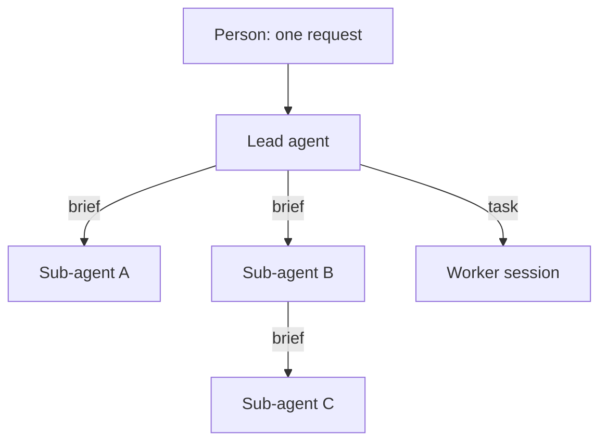
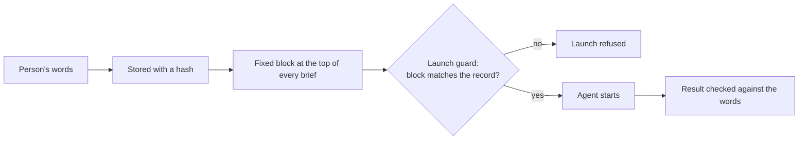
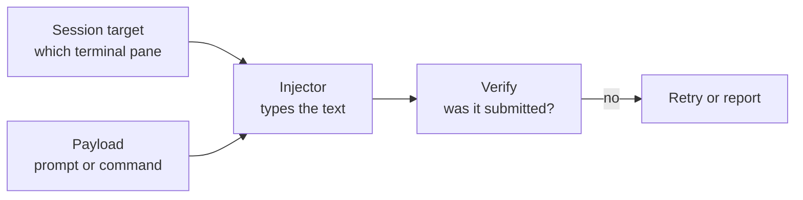



# Templates and stubs in detail

As of 2026-11-09.

This page covers how to standardise the prompts agents write for each other, how to keep the person's original request intact through many hands, and how a harness sends text into a running session. The [section overview]({{ '/sections/07-templates-and-stubs/' | relative_url }}) is the short version.

## Contents
{: .no_toc .text-delta }

1. TOC
{:toc}

## Why templates

### Who writes the prompts



One request from a person becomes many prompts written by agents. Each one is a chance to leave out a rule, misstate the goal or forget the output format.

### What a template fixes

- Every brief has the same fields, so nothing is forgotten.
- Fixed rules are copied verbatim, so they reach every agent.
- The receiving agent knows where to look for the output format and the limits.
- A reviewer can check a brief against its template.

## Stubs and document templates

### A stub

A stub is a fill-in-the-blanks prompt. The headings and fixed rules are written; the agent that uses it fills in the task-specific parts. Stubs suit prompts that are written often and must be consistent: sub-agent briefs, review requests, research questions.

### A template

A template is the full shape of one kind of document, with a description of what goes under each heading. Templates suit documents that people and agents read later: designs, plans, research reports, bug reports.

### Example: a research report template

```markdown
---
title: <question as a short label>
status: draft | complete
---
## Answer
<the answer in two to four sentences, first>

## Method
<what was searched or measured, and how>

## Findings
<one subsection per finding, each with its source>

## Open questions
<what is still unknown, and what would settle it>

## Sources
<one line per source with the date it was checked>
```

An agent asked for research fills this in. A reader always finds the answer first and the sources last.

## The brief

### The fields

| Field | What it holds | Why it matters |
|---|---|---|
| Objective | One sentence on what done looks like | The agent can tell when to stop |
| Inputs | Files, links and data to start from | Saves the agent rediscovering them |
| Output | Exact format, location and a length cap | The lead agent can read every result the same way |
| Tools and scope | Which tools, which directories, read-only or not | Limits what can go wrong |
| Boundaries | Fixed safety rules, word for word | A sub-agent has no other source for them |
| When stuck | What to try, and when to stop and report | Prevents loops and silent guessing |

### Rules travel only in the brief

A sub-agent receives none of its parent's rules unless they are in its brief. Pointing it at a rule ("follow the testing rules") does not deliver the rule. My brief stub carries the safety rules word for word for that reason.

### Example: a filled brief

```markdown
## Objective
Find every caller of `parse_date` and list which pass a timezone.

## Inputs
The repository at the current branch. Start from src/dates.py.

## Output
A Markdown table: file, line, passes timezone (yes or no). At most 40 rows.
Write it as your final answer; do not create files.

## Tools and scope
Read and search only. No edits, no shell commands that change files.

## Boundaries
- Never kill processes by name pattern; kill one PID.
- Never cite a file that is not tracked in git.

## When stuck
If a caller is generated code, list it once with "generated" and move on.
Stop after 30 minutes and report what you have.
```

## The original-request block

### The drift problem

Briefs drift as work passes through several hands. Each agent paraphrases the one before, and small changes add up. A requirement can vanish entirely while every check stays green.

### What happened once

A person asked for a feature that named prompt injection as one mechanism. Two hands later, an agent's decision record said "injection is not used", and the work went ahead without it. Every gate passed, because no gate compared the result with the original words.

### The fix



The person's words are stored with a hash and copied as a fixed block at the top of every brief. The launch guard refuses a brief whose block cannot be validated against the stored record. Each agent checks its result against those words, and a decision that would drop something the person named goes back to the person.

### Example: the block

```markdown
## Original request (verbatim, do not edit)
> add a table of contents on the landing page and the root README.md
record: asks/site-restructure.md  sha256: 9f2c...e41a
```

## Injected prompts

### What it means here

Prompt injection, in the sense used here, means the harness sending text into a live session at the right moment. The security attack with the same name is covered in [Browser automation and computer use]({{ '/sections/15-browser-automation/' | relative_url }}).

### When a harness injects

- After compaction: a reminder of the current task and the rules that matter, in case the summary dropped them.
- When a session is idle with a goal: a wake-up so it continues.
- When the context is nearly full: the compact command, so the session compacts before it runs out of room.
- When another session sends a message.

### Why typing into the terminal

A command sent as a message between sessions arrives as plain text and never runs. Claude Code's docs say cross-session messaging delivers `/compact` as text, and a scheduled `/loop` fire passes built-in commands to Claude as text. A harness that needs a session to run a built-in command at a given moment has to type it into the terminal.

### The library

My harness has a shared prompt-injection library that types a prompt or command into a live terminal session and checks it was submitted. Its interface has four parts:



A session target names which session to type into. A payload is the text. An injector types it. A verify step confirms the text was submitted and did not just sit in the input box. The goal waker, the context supervisor and the compaction path all use the same library, so a fix to how text is typed or verified lands once.

### Example: compacting before the window fills

The context supervisor reads how full a session's window is. Past a threshold, it asks the session to save its state, then injects `/compact` with a focus line naming the current task. The verify step confirms the command ran. The session continues from its saved state.

## Goal templates

A goal condition for `/goal` is a prompt too, and a vague one never ends or ends too early. Templates for common goals keep them checkable: "all tests in `<path>` pass, shown in this session's output, and the change is committed". The condition names evidence the agent will print, because the goal evaluator reads only the conversation.

## Keeping templates small

Briefs grow as each incident adds a block. A long brief costs tokens on every launch, and the important lines get lost among the rest. Prune templates as you prune context files: merge blocks that cover the same failure, and move rarely needed detail into a procedure the brief links to.

## Examples from my own harness

- A stub and a template for each kind of document, plus reusable prompt stubs and goal templates.
- The sub-agent brief stub above, with its safety rules copied word for word.
- The original-request block, stored with a hash and checked by the launch guard.
- The prompt-injection library, used to wake idle sessions that have a goal and to send the compact command when the context is nearly full.

To start: one template for the task you delegate most.

## Pitfalls and lessons

- A brief that points at a rule does not deliver it.
- Paraphrased requests drift. Carry the original words.
- A command sent as a message never runs. Type it into the terminal, and verify it was submitted.
- Templates grow. Prune them.
- Reflexivity example: briefs now carry the person's original words with a hash, because a paraphrased brief once let an agent record that a requested feature was "not used".

## Sources

- Commands in cross-session messages arrive as text: <https://code.claude.com/docs/en/cross-session-messaging.md>, verified 2026-11-09.
- Built-in commands in scheduled `/loop` fires arrive as text: <https://code.claude.com/docs/en/scheduled-tasks.md>, verified 2026-11-09.
- `/goal` evaluator reads only the conversation: <https://code.claude.com/docs/en/goal.md>, verified 2026-11-09.
- The stubs, templates, original-request block and injection library are from the author's own harness, described conceptually. The examples are illustrations written for this page.


