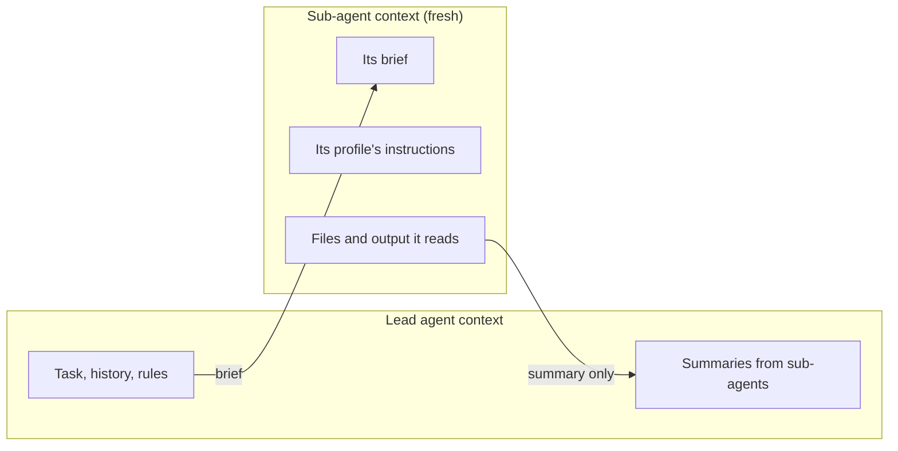
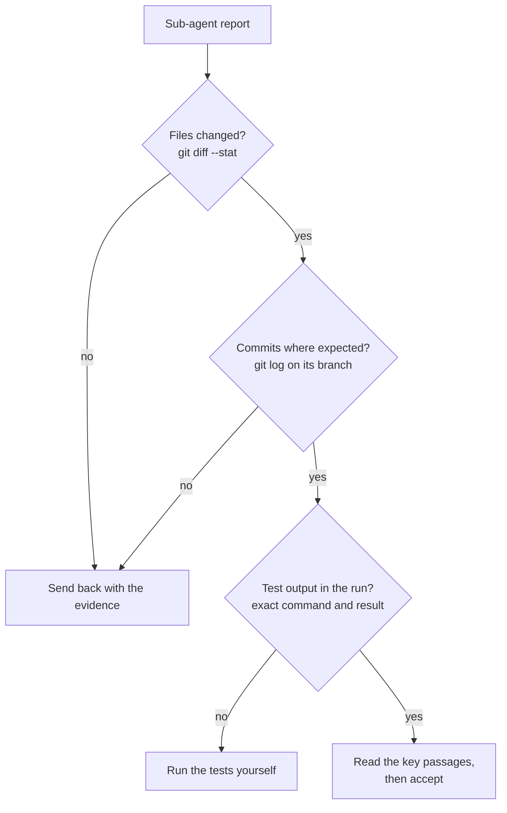



# Delegation in detail

As of 2026-11-09.

This page explains how to hand work to other agents and keep control of it: what a sub-agent sees, how profiles fix a role, how worktrees keep writers apart, how to bound nesting and concurrency, how to pick models, and how to check what comes back. The [section overview]({{ '/sections/08-delegation/' | relative_url }}) is the short version.

## Contents
{: .no_toc .text-delta }

1. TOC
{:toc}

## Sub-agents

### What a sub-agent sees



A sub-agent starts with a fresh context: its brief, its profile's instructions and the project's context files, and nothing of the lead agent's conversation. It returns a summary. The lead agent never sees the files the sub-agent read, which is the point: the lead's window stays free for coordination.

### When to delegate

- A self-contained search or research question.
- A review by a role that should not share the author's reasoning.
- Parallel work on separate parts of a change.
- A long mechanical edit across many files.

### When not to

- Work that needs the conversation's context to be done well. `/subtask` exists for this: it starts a sub-agent that inherits the conversation.
- Tiny tasks, where writing the brief costs more than doing the work.

### Example: parallel research

A lead agent planning a migration starts three sub-agents at once: one lists every database query in the service, one reads the new database's docs on transactions, one finds the tests that touch the data layer. Each returns a short report. The lead agent reads three reports and writes the plan.

## Agent profiles

### Fields

| Field | What it sets | Example |
|---|---|---|
| `name` | How the profile is called | `reviewer` |
| `description` | When to use it; the model picks profiles from this | "Reviews a diff for bugs. Read-only." |
| `tools` | Which tools it may use | `Read, Grep, Glob` |
| `model` | Which model it runs on | `opus`, `sonnet`, `haiku` |
| `isolation` | `worktree` runs it in its own git worktree | `worktree` |
| Body | Standing instructions for the role | Output format, what to ignore |

In Codex a profile is a TOML file in `.codex/agents/`, and a sub-agent inherits the parent's sandbox.

### Roles

Profiles work best as roles with clear limits. A read-only role has no write tools, so a reviewer cannot "fix" what it reviews and a researcher cannot change files by accident.

### Example: an engineer profile

```markdown
---
name: engineer
description: Implements a change described in a brief, with tests, in its own worktree.
tools: Read, Grep, Glob, Edit, Write, Bash
model: sonnet
isolation: worktree
---
Write the failing test first. Commit each logical step. Report the commit ids
and the exact test command with its last line of output.
```

## Briefs

A brief states the goal, the inputs, the exact return format and the limits. A sub-agent receives none of its parent's rules unless they are in its brief. [Templates, prompt stubs and injected prompts]({{ '/sections/07-templates-and-stubs/' | relative_url }}) covers the brief template field by field.

## Worktree isolation

### Why

Two agents editing one checkout overwrite each other's files and mix their changes in one diff. A git worktree is a second checkout of the same repository, on its own branch, in its own directory. Each writing agent gets one.

```bash
git worktree add ../repo-agent-a -b agent-a/fix-parser
git worktree add ../repo-agent-b -b agent-b/add-tests
```


### Merging back

Each agent commits on its own branch. The lead agent, or a person, reviews each branch and merges it. Conflicts surface at merge time, one branch at a time, where they can be resolved deliberately.

### Removing worktrees

A worktree holds work until it is merged. Remove one only after checking its content reached the main branch and no process is still running in it. Removing it early deletes unmerged work.

### When isolation fails

Isolation can fail: sub-agents commit onto their parent's branch, or a sub-agent working across two repositories writes into the second one's main checkout, because only the first repository had a worktree. Check where the commits landed, and give an agent a worktree in every repository it will write to.

## Nesting and concurrency

### Nesting

Sub-agents can start sub-agents, up to three levels deep by default in Claude Code. The `CLAUDE_CODE_MAX_SUBAGENT_SPAWN_DEPTH` setting changes the limit. Deep nesting makes it hard to see who did what, and each level summarises the one below, losing detail.

### Concurrency

Many agents at once slow every session on the machine: the CPU, memory and test databases are shared. Set your own bounds: how many agents run at once, and which roles may start others.

### Example: bounding the fan-out

A lead agent is allowed to start up to four engineers. Engineers may not start sub-agents of their own; researchers may start one level of helpers for searches. Before each launch, the harness checks the machine's load, and if it is busy, the lead agent does the next item itself instead of waiting.

## Model choice

| Task | Model tier | Why |
|---|---|---|
| Design decisions, plans, synthesis of many reports | Strongest | Mistakes here are expensive and spread |
| Implementing a clear brief | Mid | Good code at lower cost |
| Bulk reading, searching, classifying | Cheapest | Volume work with checkable output |
| Review of another model's work | A different family | Does not share the author's blind spots |

`/model` and `/effort` choose the model and reasoning effort for a session; a profile's `model` field fixes it for a role.

## Agent teams

Agent teams, where agents message each other directly without going through a lead, are experimental in Claude Code and off by default. Most delegation today is hub-shaped: a lead and its sub-agents.

## Checking delegated work

### Agents report work they did not do

Agents report work they did not do: a complete fix report with passing tests while no file changed, or a summary that says two records were filed when none were. Check the artifact, never the report alone.

### What to check



### Summaries drop caveats

A summary can drop the caveat that changes the conclusion: "the API supports batching" without "only on the paid tier". For decisions that rest on a sub-agent's research, read the key passages of the source yourself.

### Example: a dropped caveat

A research sub-agent reports "the library supports streaming responses". The lead agent opens the cited page and finds "streaming is experimental and disabled by default". The plan changes before any code is written.

## Examples from my own harness

### Profiles by role

My harness has agent profiles by role: analyst, architect, auditor, engineer, planner, researcher and reviewer. Read-only roles have no write tools. Each profile also states whether that role may start sub-agents, and a check fails the build if a profile's stated authority and its tools disagree.

### Launch guards

A guard refuses to launch a writing sub-agent without its own worktree. Another check reads the machine's load before each launch, so many agents at once do not slow every session; when the machine is busy, the launching session works the next item itself.

### Cross-family review

Codex reviews what Claude writes (see [Code review]({{ '/sections/13-code-review/' | relative_url }})).

### Recording who did what

Each commit records the delegation in trailers: family and role, tier, model, effort, profile, worktree and session. When a change goes wrong, the record shows which agent wrote it and under which brief.

```text
fix(parser): accept leap-day dates

Agent-Family: claude
Agent-Role: engineer
Agent-Model: <model id>
Agent-Effort: high
Agent-Worktree: <worktree name>
```

### Worktree removal

A worktree is removed only after an audit proves its content reached the main branch, and a live process inside it blocks removal.

To start: one read-only researcher profile and one brief template.

## Pitfalls and lessons

- A sub-agent's summary can drop a caveat that changes the conclusion. Read the key passages yourself.
- Agents report work they did not do. Check the files, the commits and the test output.
- Isolation can fail. Check where the commits landed.
- Unbounded fan-out slows every session. Set limits on concurrency and nesting.

## Sources

- Sub-agent profiles, fields, `isolation`, nesting depth: <https://code.claude.com/docs/en/sub-agents.md>, verified 2026-11-09.
- `/tasks`, `/subtask`, `/fork`, `/model`, `/effort`: <https://code.claude.com/docs/en/commands.md>, verified 2026-11-09.
- Agent teams: <https://code.claude.com/docs/en/agent-teams.md>, verified 2026-11-08.
- Codex sub-agents: <https://learn.chatgpt.com/docs/agent-configuration/subagents.md>, verified 2026-11-08.
- The profiles, launch guards, trailers and worktree audit are from the author's own harness, described conceptually. The trailer names shown are illustrative. The other examples are illustrations written for this page.


